# Informe de ejecución de pruebas – ITMentorSoft

Generado: 2026-10-23 14:39 · Aplicación: https://itmentorsoft.com · Herramienta: Katalon Studio 11.6 · Perfil: `default` · Navegador: Chrome

Fuente: logs de Katalon en `Reports/` y evidencias del keyword `Evidencia`. Las capturas de la última ejecución de cada caso se copiaron a `Documentacion/Evidencias_Ejecucion/`. El reporte visual está en `Documentacion/Reporte_Pruebas.html`. La clasificación de los 43 casos de Azure DevOps y su trazabilidad con estos casos está en `Documentacion/Inventario_Casos_Azure.md`; los defectos y observaciones, al final de este informe.

## Resumen

| Caso | Descripción | Origen | Resultado | Fecha | Duración | Intentos |
|---|---|---|---|---|---|---|
| TC01 | Aislamiento de datos académicos entre estudiantes | Azure #496 · HU 1.2.2 CA2, CA3 · Riesgo RH01 / R03 | ✅ PASSED | 2026-10-23 14:34 | 0 min 52 s | 2 |
| TC02 | Restricción de acceso por rol a la administración de evaluaciones | Azure #466 · HU 2.1.3 CA1 · Riesgo RH02 / R03 + R01 | ✅ PASSED | 2026-10-23 14:35 | 0 min 51 s | 2 |
| TC03 | Evaluación secuencial y persistencia de respuestas | Azure #434 · HU 2.1.1 CA2, CA3, CR-006 · Riesgo RH03 | ✅ PASSED | 2026-10-23 14:37 | 0 min 45 s | 4 |
| TC04 | Login: errores de formato y mensaje genérico | Azure #483 · HU 1.1.2 | ✅ PASSED | 2026-10-23 13:42 | 0 min 37 s | 4 |
| TC05 | Registro: límites de longitud y formato | Azure #478 · HU 1.1.1 | ✅ PASSED | 2026-10-23 13:43 | 1 min 00 s | 1 |
| TC06 | Registro: unicidad de usuario y correo | Azure #482 · HU 1.1.1 | ✅ PASSED | 2026-10-23 13:45 | 0 min 37 s | 1 |
| TC07 | Login exitoso: cookie segura, vigencia y redirección por rol | Azure #485 · HU 1.1.2 CA5 | ❌ FAILED | 2026-10-23 13:59 | 2 min 09 s | 1 |
| TC08 | Recuperación de contraseña: mensaje genérico | Azure #486 · HU 1.1.3 | ✅ PASSED | 2026-10-23 13:52 | 0 min 33 s | 2 |
| TC09 | Restablecimiento: enlace inválido o vencido y complejidad | Azure #488, #486 · HU 1.1.3 | ❌ FAILED | 2026-10-23 13:54 | 4 min 37 s | 2 |
| TC10 | Middleware de autorización: HTTP 401 y 403 | Azure #494, #489 · HU 1.2.1 | ✅ PASSED | 2026-10-23 14:14 | 0 min 33 s | 2 |
| TC11 | Ingreso al módulo de evaluación inicial | Azure #422 · HU 2.1.1 | ❌ FAILED | 2026-10-23 14:32 | 0 min 56 s | 2 |
| TC12 | Finalización y retroalimentación de la evaluación | Azure #435, #457 · HU 2.1.1, 4.2.1 | ✅ PASSED | 2026-10-23 14:16 | 2 min 02 s | 1 |
| TC13 | Progreso, perfil de conocimiento y categoría del estudiante | Azure #426, #451, #459, #465, #475 | ✅ PASSED | 2026-10-23 14:26 | 0 min 35 s | 1 |
| TC14 | Ruta de aprendizaje y recomendaciones | Azure #436, #446, #461 | ✅ PASSED | 2026-10-23 14:27 | 0 min 56 s | 1 |
| TC15 | Calificación de recursos recomendados | Azure #448 | ✅ PASSED | 2026-10-23 14:30 | 0 min 49 s | 2 |
| TC16 | Acceso por rol a reportes y JSON consolidado | Azure #450, #500 | ✅ PASSED | 2026-10-23 14:02 | 0 min 47 s | 1 |
| TC17 | Reportes gráficos, consolidación y filtro por nivel | Azure #502, #418, #476, #455 | ✅ PASSED | 2026-10-23 14:03 | 0 min 48 s | 1 |
| TC18 | Reportes de recursos y del banco de preguntas | Azure #440, #444 | ✅ PASSED | 2026-10-23 14:04 | 1 min 30 s | 1 |
| TC19 | Gestión de recursos: validaciones y consulta | Azure #430 | ✅ PASSED | 2026-10-23 14:10 | 1 min 02 s | 2 |
| TC20 | Banco de preguntas: paginación, filtros y versiones | Azure #468, #499 | ✅ PASSED | 2026-10-23 14:11 | 1 min 15 s | 1 |

Convención: **PASSED** = se cumplieron todas las verificaciones (las advertencias son observaciones sobre el requisito); **FAILED** = defecto funcional; **ERROR** = la prueba no se pudo completar (configuración, login/OTP o precondición).

## TC01 – Aislamiento de datos académicos entre estudiantes

`TC01_HU122_Aislamiento_datos_academicos_entre_estudiantes` · Azure #496 · HU 1.2.2 CA2, CA3 · Riesgo RH01 / R03

**Resultado de la última ejecución:** ✅ PASSED · 2026-10-23 14:34:36 · 0 min 52 s · log `Reports\20261023_143352\TS_TC01\20261023_143352\execution0.log`

**Bitácora de la ejecución:**

1. Configuración completa. Perfil: default
2. Sesión de la cuenta DOCENTE reutilizada (https://itmentorsoft.com/teacher/dashboard)
3. Guía de bienvenida omitida
4. Lista de estudiantes (sesión Docente): HTTP 200
5. Sesión cerrada (sessionStorage y cookies eliminados)
6. Sesión de la cuenta ESTUDIANTE_A reutilizada (https://itmentorsoft.com/student/dashboard)
7. Guía de bienvenida omitida
8. Estudiante A: 0e286d5678b3455a83be2bba59a8f7ab | Estudiante B: 456c662101ff4db99eaf214c2d30300a
9. Captura: C:\Users\Jhon Mario R\Documents\Edison\claude\pruebas_aceptacion\ITMentorSoft_Katalon_SQA\Evidencias\TC01\20261023_143524_570_01_resultados_propios.png
10. Control positivo - datos propios por API: HTTP 200 {"is_success":true,"message":"Resumen del estudiante obtenido exitosamente","summary":{"student_id":"0e286d5678b3455a83be2bba59a8f7ab","name":"Edison Restrepo","knowledge_classification":"básico","profile":[{"topic":"Principios de arquitectura y mantenibilidad","score":8.0}],"feedback":"El estudiant…
11. Solicitud de datos ajenos /reports/student_summary?id=456c662101ff4db99eaf214c2d30300a -> HTTP 404 {"status":404,"message":"User not found","path":"/reports/student_summary"}
12. Solicitud de datos ajenos /assessments/summary?student_id=456c662101ff4db99eaf214c2d30300a&page=0&page_size=20 -> HTTP 404 {"status":404,"message":"User not found","path":"/assessments/summary"}
13. Solicitud de vista ajena: https://itmentorsoft.com/teacher/students/456c662101ff4db99eaf214c2d30300a
14. Captura: C:\Users\Jhon Mario R\Documents\Edison\claude\pruebas_aceptacion\ITMentorSoft_Katalon_SQA\Evidencias\TC01\20261023_143528_192_02_solicitud_resultados_estudiante_B.png
15. URL final tras la solicitud: https://itmentorsoft.com/login
16. Verificaciones de aislamiento finalizadas (ver estado del caso en el reporte)

**Evidencias:**

*01_resultados_propios*

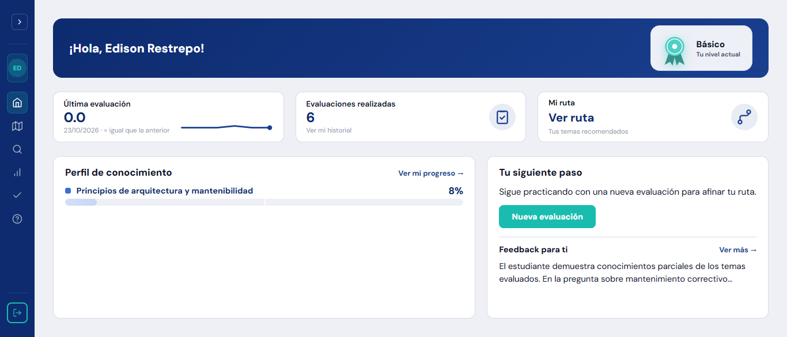

*02_solicitud_resultados_estudiante_B*

**Historial de intentos:**

| # | Fecha | Resultado | Motivo |
|---|---|---|---|
| 1 | 2026-10-21 21:46 | ✅ PASSED |  |
| 2 | 2026-10-23 14:34 | ✅ PASSED |  |

## TC02 – Restricción de acceso por rol a la administración de evaluaciones

`TC02_HU213_Restriccion_acceso_por_rol_a_administracion_de_evaluaciones` · Azure #466 · HU 2.1.3 CA1 · Riesgo RH02 / R03 + R01

**Resultado de la última ejecución:** ✅ PASSED · 2026-10-23 14:35:59 · 0 min 51 s · log `Reports\20261023_143537\TS_TC02\20261023_143537\execution0.log`

**Advertencias:**

- [TC02] Observación HU 2.1.3 CA1: no se verificó el mensaje de autorización (columna mensaje_denegacion_esperado vacía). La aplicación redirige sin mensaje; URL final: https://itmentorsoft.com/login.

**Bitácora de la ejecución:**

1. Configuración completa. Perfil: default
2. Sesión de la cuenta ESTUDIANTE reutilizada (https://itmentorsoft.com/student/dashboard)
3. Guía de bienvenida omitida
4. Rol ESTUDIANTE - API banco de preguntas: HTTP 403 {"status":403,"message":"Not enough permissions","path":"/assessments/all-questions"}
5. Captura: C:\Users\Jhon Mario R\Documents\Edison\claude\pruebas_aceptacion\ITMentorSoft_Katalon_SQA\Evidencias\TC02\20261023_143638_650_1_ESTUDIANTE_acceso_denegado.png
6. Rol ESTUDIANTE - URL final al pedir el módulo: https://itmentorsoft.com/login
7. Sesión cerrada (sessionStorage y cookies eliminados)
8. Sesión de la cuenta DOCENTE reutilizada (https://itmentorsoft.com/teacher/dashboard)
9. Guía de bienvenida omitida
10. Rol DOCENTE - API banco de preguntas: HTTP 200 {"is_success":true,"message":"Preguntas obtenidas exitosamente","questions":[{"question_id":"38d03f2b90e246d88d992d3334a26171","text_to_evaluate":"Una variable p guarda el precio de un producto. Propón un nombre más claro y explica cómo ayuda a quien lee el programa.","concept":"Legibilidad y nombre…
11. Captura: C:\Users\Jhon Mario R\Documents\Edison\claude\pruebas_aceptacion\ITMentorSoft_Katalon_SQA\Evidencias\TC02\20261023_143649_109_2_DOCENTE_acceso_permitido.png
12. Sesión cerrada (sessionStorage y cookies eliminados)
13. Iteraciones por rol finalizadas (ver estado del caso en el reporte)

**Evidencias:**

*1_ESTUDIANTE_acceso_denegado*

*2_DOCENTE_acceso_permitido*

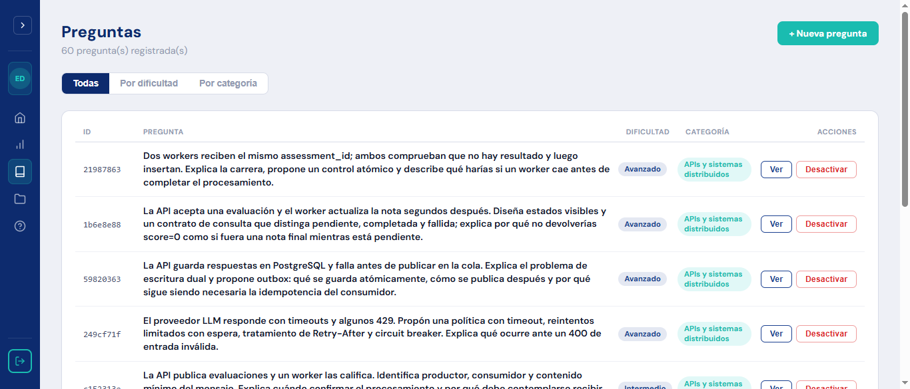

**Historial de intentos:**

| # | Fecha | Resultado | Motivo |
|---|---|---|---|
| 1 | 2026-10-21 21:49 | ✅ PASSED |  |
| 2 | 2026-10-23 14:35 | ✅ PASSED |  |

## TC03 – Evaluación secuencial y persistencia de respuestas

`TC03_HU211_Evaluacion_inicial_secuencial_y_persistencia_de_respuestas` · Azure #434 · HU 2.1.1 CA2, CA3, CR-006 · Riesgo RH03

**Resultado de la última ejecución:** ✅ PASSED · 2026-10-23 14:37:13 · 0 min 45 s · log `Reports\20261023_143656\TS_TC03\20261023_143656\execution0.log`

**Advertencias:**

- [TC03] Observación HU 2.1.1 CA2: la interfaz ofrece 'Anterior' y el panel 'Tus preguntas' para saltar entre preguntas. La redacción de Azure dice 'sin permitir saltar entre preguntas ni retroceder'; confirmar con producto cuál es el comportamiento vigente.

**Bitácora de la ejecución:**

1. Configuración completa. Perfil: default
2. Sesión de la cuenta ESTUDIANTE_EVAL reutilizada (https://itmentorsoft.com/student/dashboard)
3. Guía de bienvenida omitida
4. Tema: Principios de arquitectura y mantenibilidad
5. Captura: C:\Users\Jhon Mario R\Documents\Edison\claude\pruebas_aceptacion\ITMentorSoft_Katalon_SQA\Evidencias\TC03\20261023_143744_334_01_pregunta_1.png
6. Pregunta 1 ([1, 5]): Una función muestra un formulario, calcula descuentos y ejecuta SQL. Identifica esas tres responsabilidades, propone dónde separar cada una y explica un beneficio de la separación.
7. Captura: C:\Users\Jhon Mario R\Documents\Edison\claude\pruebas_aceptacion\ITMentorSoft_Katalon_SQA\Evidencias\TC03\20261023_143748_479_02_pregunta_2.png
8. Pregunta 2: Dos funciones repiten la misma validación de correo. Explica una refactorización posible, cómo verificar que conserva el comportamiento y cómo se relaciona esta duplicación con la deuda técnica.
9. Captura: C:\Users\Jhon Mario R\Documents\Edison\claude\pruebas_aceptacion\ITMentorSoft_Katalon_SQA\Evidencias\TC03\20261023_143750_366_03_evaluacion_en_curso.png
10. Evaluación en curso: Tienes una evaluación en curso Principios de arquitectura y mantenibilidad · 1 de 5 respondidas · hoy Retomar Descartar
11. Captura: C:\Users\Jhon Mario R\Documents\Edison\claude\pruebas_aceptacion\ITMentorSoft_Katalon_SQA\Evidencias\TC03\20261023_143753_246_04_reingreso.png
12. Pregunta al retomar: Dos funciones repiten la misma validación de correo. Explica una refactorización posible, cómo verificar que conserva el comportamiento y cómo se relaciona esta duplicación con la deuda técnica.
13. Captura: C:\Users\Jhon Mario R\Documents\Edison\claude\pruebas_aceptacion\ITMentorSoft_Katalon_SQA\Evidencias\TC03\20261023_143755_528_05_respuesta_1_conservada.png
14. Verificaciones de flujo secuencial y persistencia finalizadas (ver estado del caso en el reporte)
15. Limpieza: evaluación en curso descartada

**Evidencias:**

*01_pregunta_1*

*02_pregunta_2*

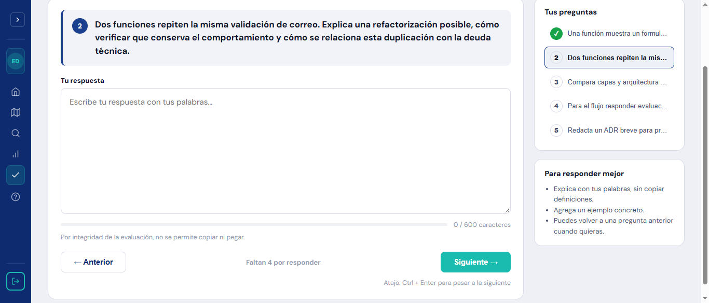

*03_evaluacion_en_curso*

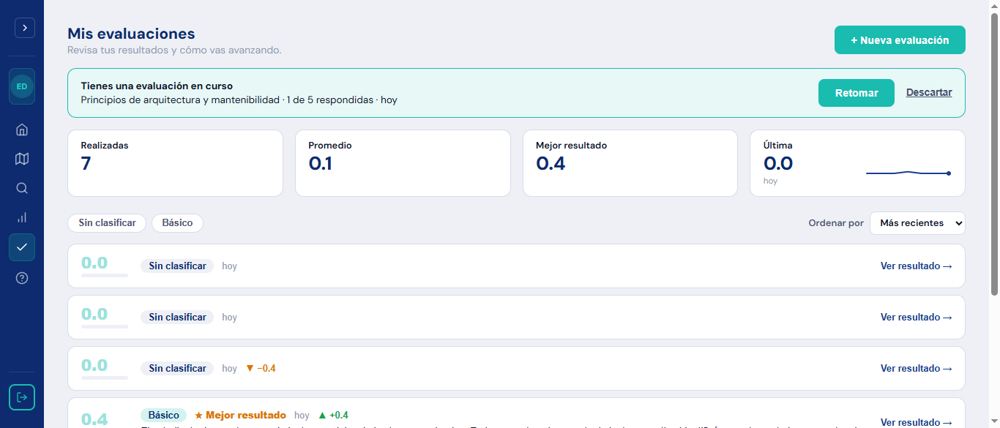

*04_reingreso*

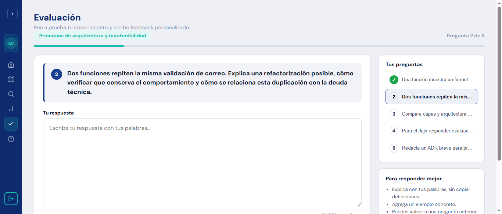

*05_respuesta_1_conservada*

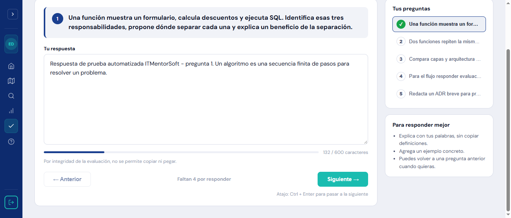

**Historial de intentos:**

| # | Fecha | Resultado | Motivo |
|---|---|---|---|
| 1 | 2026-10-21 21:33 | ⚠️ ERROR | Test Cases/TC03_HU211_Evaluacion_inicial_secuencial_y_persistencia_de_respuestas FAILED. Reason: java.lang.IllegalArgumentException: Cannot find test data with id 'Data Files/TD_TC03_Respuestas' because (of) 'java.lang.I |
| 2 | 2026-10-21 21:35 | ❌ FAILED | Unable to click on object 'Object Repository/Evaluacion_Inicial/Page_EvaluacionInicial/btn_IniciarEvaluacion' (Root cause: com.kms.katalon.core.exception.StepFailedException: Unable to click on object 'Object Repository/ |
| 3 | 2026-10-21 21:42 | ✅ PASSED |  |
| 4 | 2026-10-23 14:37 | ✅ PASSED |  |

## TC04 – Login: errores de formato y mensaje genérico

`TC04_AZ483_Login_errores_de_formato_y_mensaje_generico` · Azure #483 · HU 1.1.2

**Resultado de la última ejecución:** ✅ PASSED · 2026-10-23 13:42:35 · 0 min 37 s · log `Reports\20261023_134217\TS_TC04\20261023_134217\execution0.log`

**Advertencias:**

- [TC04] Observación #483: el mensaje genérico es 'No se pudo iniciar sesión | Correo o contraseña incorrectos.'; Azure indica el texto 'Usuario o contraseña incorrectas'. Es genérico y no revela el dato, pero el texto difiere.

**Bitácora de la ejecución:**

1. Configuración completa. Perfil: default
2. Campos vacíos -> error de 'email': 'El correo electrónico es requerido'
3. Campos vacíos -> error de 'password': 'La contraseña es requerida'
4. Correo con formato inválido -> error de 'email': 'Ingresa un correo electrónico válido'
5. Contraseña corta -> error de 'password': 'La contraseña debe tener al menos 6 caracteres'
6. Captura: C:\Users\Jhon Mario R\Documents\Edison\claude\pruebas_aceptacion\ITMentorSoft_Katalon_SQA\Evidencias\TC04\20261023_134257_560_01_errores_de_formato.png
7. Captura: C:\Users\Jhon Mario R\Documents\Edison\claude\pruebas_aceptacion\ITMentorSoft_Katalon_SQA\Evidencias\TC04\20261023_134305_440_02_correo_registrado_clave_incorrecta.png
8. Correo registrado + clave incorrecta -> 'No se pudo iniciar sesión | Correo o contraseña incorrectos.', alerta '¿Aún no tienes cuenta? Regístrate' (ruta /login)
9. Captura: C:\Users\Jhon Mario R\Documents\Edison\claude\pruebas_aceptacion\ITMentorSoft_Katalon_SQA\Evidencias\TC04\20261023_134312_529_03_correo_no_registrado.png
10. Correo no registrado -> 'No se pudo iniciar sesión | Correo o contraseña incorrectos.', alerta '¿Aún no tienes cuenta? Regístrate' (ruta /login)

**Evidencias:**

*01_errores_de_formato*

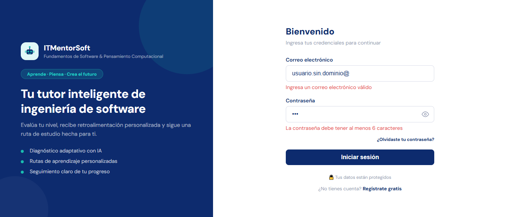

*02_correo_registrado_clave_incorrecta*

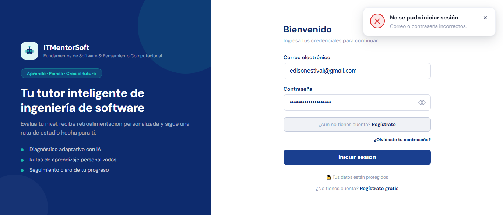

*03_correo_no_registrado*

**Historial de intentos:**

| # | Fecha | Resultado | Motivo |
|---|---|---|---|
| 1 | 2026-10-23 13:37 | ❌ FAILED | Unable to send keys 'usuario.sin.dominio@' to object 'Object Repository/Comun/txt_Campo' (Root cause: com.kms.katalon.core.exception.StepFailedException: Unable to send keys 'usuario.sin.dominio@' to object 'Object Repos |
| 2 | 2026-10-23 13:40 | ✅ PASSED |  |
| 3 | 2026-10-23 13:41 | ❌ FAILED | Unable to maximize current window (Root cause: com.kms.katalon.core.exception.StepFailedException: Unable to maximize current window 	at com.kms.katalon.core.webui.keyword.internal.WebUIKeywordMain.stepFailed(WebUIKeywor |
| 4 | 2026-10-23 13:42 | ✅ PASSED |  |

## TC05 – Registro: límites de longitud y formato

`TC05_AZ478_Registro_limites_de_longitud_y_formato` · Azure #478 · HU 1.1.1

**Resultado de la última ejecución:** ✅ PASSED · 2026-10-23 13:43:40 · 1 min 00 s · log `Reports\20261023_134325\TS_TC05\20261023_134325\execution0.log`

**Bitácora de la ejecución:**

1. Configuración completa. Perfil: default
2. Nombre vacío: campo 'name' (0 car.) -> 'El nombre es requerido'
3. Nombre por debajo del mínimo (3): campo 'name' (2 car.) -> 'Mínimo 3 caracteres'
4. Nombre por encima del máximo (100): campo 'name' (101 car.) -> 'Máximo 100 caracteres'
5. Usuario vacío: campo 'username' (0 car.) -> 'El nombre de usuario es requerido'
6. Usuario por debajo del mínimo (3): campo 'username' (2 car.) -> 'Mínimo 3 caracteres'
7. Usuario por encima del máximo (20): campo 'username' (21 car.) -> 'Máximo 20 caracteres'
8. Usuario con caracteres no permitidos: campo 'username' (20 car.) -> 'Solo letras, números y guion bajo'
9. Correo vacío: campo 'email' (0 car.) -> 'El correo electrónico es requerido'
10. Correo sin dominio: campo 'email' (7 car.) -> 'Ingresa un correo electrónico válido'
11. Contraseña vacía: campo 'password' (0 car.) -> 'La contraseña es requerida'
12. Confirmación vacía: campo 'confirmPassword' (0 car.) -> 'Confirma tu contraseña'
13. Captura: C:\Users\Jhon Mario R\Documents\Edison\claude\pruebas_aceptacion\ITMentorSoft_Katalon_SQA\Evidencias\TC05\20261023_134414_711_01_errores_por_campo.png
14. Contraseña de 3 caracteres -> reglas cumplidas 1 de 4
15. Contraseña de 6 caracteres -> reglas cumplidas 2 de 4
16. Contraseña de 7 caracteres -> reglas cumplidas 3 de 4
17. Contraseña de 8 caracteres -> reglas cumplidas 4 de 4
18. Contraseña de 21 caracteres -> reglas cumplidas 3 de 4
19. Captura: C:\Users\Jhon Mario R\Documents\Edison\claude\pruebas_aceptacion\ITMentorSoft_Katalon_SQA\Evidencias\TC05\20261023_134426_388_02_reglas_contrasena.png
20. Captura: C:\Users\Jhon Mario R\Documents\Edison\claude\pruebas_aceptacion\ITMentorSoft_Katalon_SQA\Evidencias\TC05\20261023_134437_623_03_envio_bloqueado.png
21. Envío con datos inválidos -> ruta /register, notificación: 'null'

**Evidencias:**

*01_errores_por_campo*

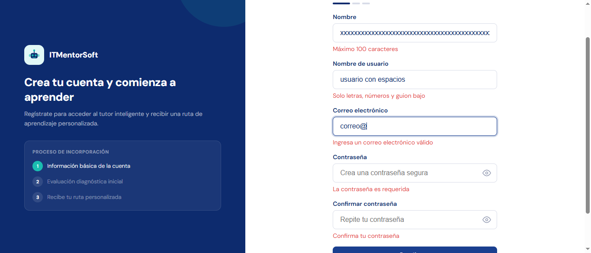

*02_reglas_contrasena*

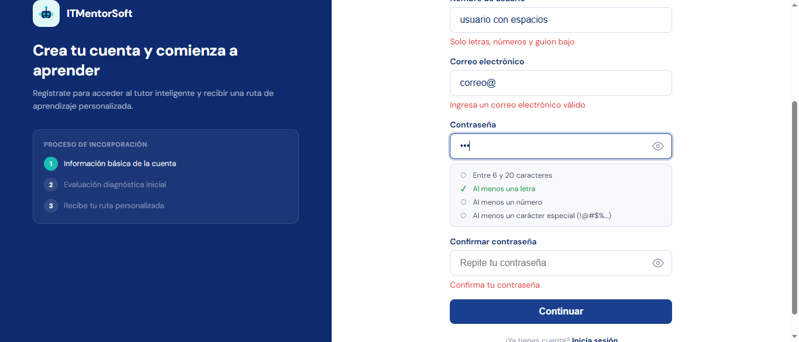

*03_envio_bloqueado*

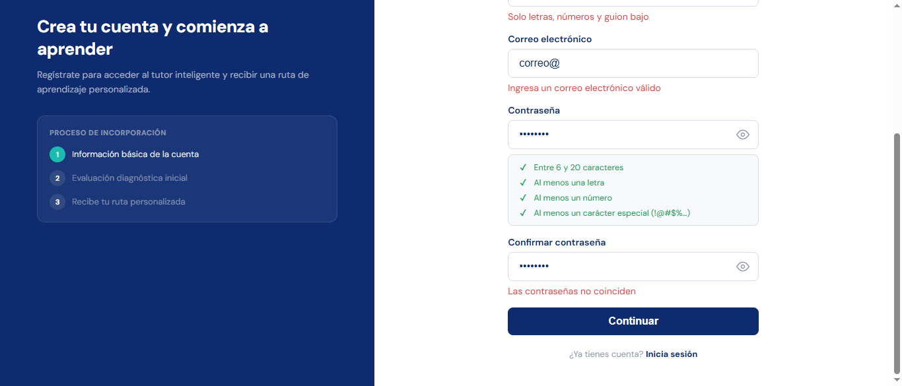

## TC06 – Registro: unicidad de usuario y correo

`TC06_AZ482_Registro_unicidad_de_usuario_y_correo` · Azure #482 · HU 1.1.1

**Resultado de la última ejecución:** ✅ PASSED · 2026-10-23 13:45:05 · 0 min 37 s · log `Reports\20261023_134452\TS_TC06\20261023_134452\execution0.log`

**Bitácora de la ejecución:**

1. Configuración completa. Perfil: default
2. Captura: C:\Users\Jhon Mario R\Documents\Edison\claude\pruebas_aceptacion\ITMentorSoft_Katalon_SQA\Evidencias\TC06\20261023_134536_501_01_formulario_con_datos_existentes.png
3. Captura: C:\Users\Jhon Mario R\Documents\Edison\claude\pruebas_aceptacion\ITMentorSoft_Katalon_SQA\Evidencias\TC06\20261023_134541_730_02_respuesta_registro_duplicado.png
4. Registro con usuario 'edison' y correo existentes -> 'No se pudo crear la cuenta | El email ya está en uso' (ruta /register)

**Evidencias:**

*01_formulario_con_datos_existentes*

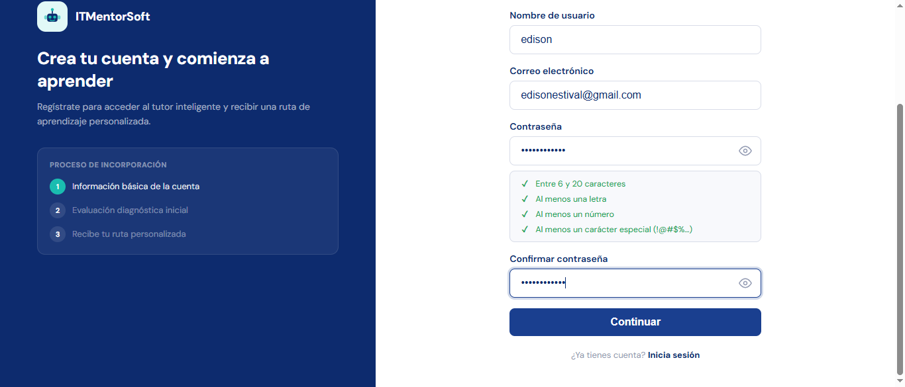

*02_respuesta_registro_duplicado*

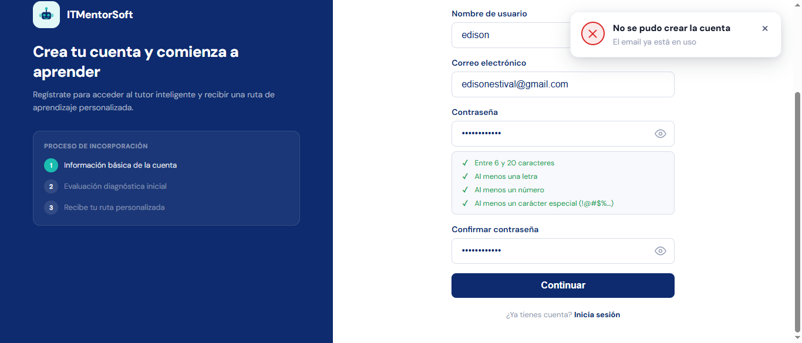

## TC07 – Login exitoso: cookie segura, vigencia y redirección por rol

`TC07_AZ485_Login_exitoso_cookie_segura_y_redireccion_por_rol` · Azure #485 · HU 1.1.2 CA5

**Resultado de la última ejecución:** ❌ FAILED · 2026-10-23 13:59:40 · 2 min 09 s · log `Reports\20261023_135930\TS_TC07\20261023_135930\execution0.log`

**Defectos (FAILED):**

- [TC07] DEFECTO: el token del rol ESTUDIANTE vence en 3597 s; #485 exige una vigencia de 15 minutos.
- [TC07] DEFECTO: el token del rol DOCENTE vence en 3597 s; #485 exige una vigencia de 15 minutos.
- Test Cases/TC07_AZ485_Login_exitoso_cookie_segura_y_redireccion_por_rol FAILED.
Reason:
com.kms.katalon.core.exception.StepFailedException: [TC07] DEFECTO: el token del rol ESTUDIANTE vence en 3597 s; #485 exige una vigencia de 15 minutos.
	at com.kms.katalon.core.util.KeywordUtil.markFailed(KeywordUtil.java:19)
	at Script1792780632449$_run_closure2.doCall(Script1792780632449.groovy:74)
	at java.base/jdk.internal.reflect.DirectMethodHandleAccessor.invoke(DirectMethodHandleAccessor.java:103)
	at TC07_AZ485_Login_exitoso_cookie_segura_y_redireccion_por_rol.run(TC07_AZ485_Login_exitoso_cookie_segura_y_redireccion_por_rol:35)
	at com.kms.katalon.core.main.ScriptEngine.run(ScriptEngine.java:203)
	at com.kms.katalon.core.main.ScriptEngine.runScriptAsRawText(ScriptEngine.java:115)
	at com.kms.katalon.core.main.TestCaseExecutor.runScript(TestCaseExecutor.java:533)
	at com.kms.katalon.core.main.TestCaseExecutor.doExecute(TestCaseExecutor.java:524)
	at com.kms.katalon.core.main.TestCaseExecutor.processExecutionPhase(TestCaseExecutor.java:503)
	at com.kms.katalon.core.main.TestCaseExecutor.accessMainPhase(TestCaseExecutor.java:495)
	at com.kms.katalon.core.main.TestCaseExecutor.execute(TestCaseExecutor.java:359)
	at com.kms.katalon.core.common.CommonExecutor.accessTestCaseMainPhase(CommonExecutor.java:71)
	at com.kms.katalon.core.main.TestSuiteExecutor.accessTestSuiteMainPhase(TestSuiteExecutor.java:188)
	at com.kms.katalon.core.main.TestSuiteExecutor.execute(TestSuiteExecutor.java:115)
	at com.kms.katalon.core.main.TestCaseMain.startTestSuite(TestCaseMain.java:241)
	at S1023_13.run(S1023_13.groovy:41)
	at java.base/jdk.internal.reflect.DirectMethodHandleAccessor.invoke(DirectMethodHandleAccessor.java:103)

**Advertencias:**

- [TC07] Observación de seguridad #485: además de la cookie HttpOnly, el frontend guarda una copia del JWT en sessionStorage ('auth_token'), accesible desde JavaScript.

**Bitácora de la ejecución:**

1. Configuración completa. Perfil: default
2. ACCIÓN MANUAL: escriba en el navegador el código OTP enviado a edisonestival@gmail.com y pulse 'Verificar e ingresar' (espera máxima 180 s).
3. Sesión iniciada con la cuenta ESTUDIANTE (https://itmentorsoft.com/student/dashboard)
4. Guía de bienvenida omitida
5. Captura: C:\Users\Jhon Mario R\Documents\Edison\claude\pruebas_aceptacion\ITMentorSoft_Katalon_SQA\Evidencias\TC07\20261023_140042_143_ESTUDIANTE_bienvenida.png
6. Rol ESTUDIANTE - cookie access_token: HttpOnly=true, Secure=true, dominio=itmentorsoft.com; document.cookie expone access_token: false
7. Rol ESTUDIANTE - vigencia restante del token: 3597 s (esperado ≤ 900 s)
8. ACCIÓN MANUAL: escriba en el navegador el código OTP enviado a edisonrestrepo68991@correo.itm.edu.co y pulse 'Verificar e ingresar' (espera máxima 180 s).
9. Sesión iniciada con la cuenta DOCENTE (https://itmentorsoft.com/teacher/dashboard)
10. Guía de bienvenida omitida
11. Captura: C:\Users\Jhon Mario R\Documents\Edison\claude\pruebas_aceptacion\ITMentorSoft_Katalon_SQA\Evidencias\TC07\20261023_140149_327_DOCENTE_bienvenida.png
12. Rol DOCENTE - cookie access_token: HttpOnly=true, Secure=true, dominio=itmentorsoft.com; document.cookie expone access_token: false
13. Rol DOCENTE - vigencia restante del token: 3597 s (esperado ≤ 900 s)

**Evidencias:**

*ESTUDIANTE_bienvenida*

*DOCENTE_bienvenida*

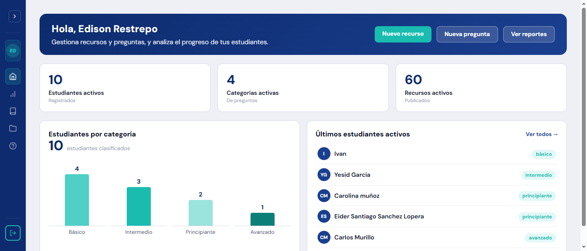

## TC08 – Recuperación de contraseña: mensaje genérico

`TC08_AZ486_Recuperacion_mensaje_generico_y_vigencia` · Azure #486 · HU 1.1.3

**Resultado de la última ejecución:** ✅ PASSED · 2026-10-23 13:52:16 · 0 min 33 s · log `Reports\20261023_135207\TS_TC08\20261023_135207\execution0.log`

**Bitácora de la ejecución:**

1. Configuración completa. Perfil: default
2. Correo con formato inválido -> 'Ingresa un correo electrónico válido'
3. Captura: C:\Users\Jhon Mario R\Documents\Edison\claude\pruebas_aceptacion\ITMentorSoft_Katalon_SQA\Evidencias\TC08\20261023_135242_657_01_correo_registrado.png
4. 01_correo_registrado -> título 'Revisa tu correo', mensaje 'Si el correo está registrado, te enviamos un enlace para restablecer tu contraseña, válido por 5 minutos. Por seguridad no confirmamos si el correo existe en el sistema.'
5. Captura: C:\Users\Jhon Mario R\Documents\Edison\claude\pruebas_aceptacion\ITMentorSoft_Katalon_SQA\Evidencias\TC08\20261023_135250_054_02_correo_no_registrado.png
6. 02_correo_no_registrado -> título 'Revisa tu correo', mensaje 'Si el correo está registrado, te enviamos un enlace para restablecer tu contraseña, válido por 5 minutos. Por seguridad no confirmamos si el correo existe en el sistema.'
7. Solicitud enviada para edisonestival@gmail.com a las 2026-10-23 13:52:50: verificar la recepción del correo de recuperación.

**Evidencias:**

*01_correo_registrado*

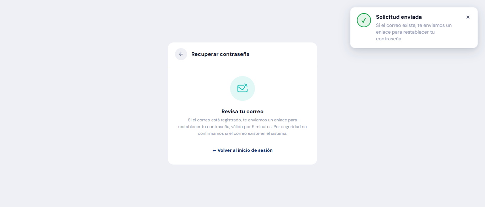

*02_correo_no_registrado*

**Historial de intentos:**

| # | Fecha | Resultado | Motivo |
|---|---|---|---|
| 1 | 2026-10-23 13:46 | ✅ PASSED |  |
| 2 | 2026-10-23 13:52 | ✅ PASSED |  |

## TC09 – Restablecimiento: enlace inválido o vencido y complejidad

`TC09_AZ488_Restablecimiento_enlace_invalido_y_complejidad` · Azure #488, #486 · HU 1.1.3

**Resultado de la última ejecución:** ❌ FAILED · 2026-10-23 13:54:23 · 4 min 37 s · log `Reports\20261023_135414\TS_TC09\20261023_135414\execution0.log`

**Defectos (FAILED):**

- [TC09] DEFECTO: un enlace de recuperación con más de 5 minutos de emitido sigue siendo válido. Incumple #486/#488.
- Test Cases/TC09_AZ488_Restablecimiento_enlace_invalido_y_complejidad FAILED.
Reason:
com.kms.katalon.core.exception.StepFailedException: [TC09] DEFECTO: un enlace de recuperación con más de 5 minutos de emitido sigue siendo válido. Incumple #486/#488.
	at com.kms.katalon.core.util.KeywordUtil.markFailed(KeywordUtil.java:19)
	at TC09_AZ488_Restablecimiento_enlace_invalido_y_complejidad.run(TC09_AZ488_Restablecimiento_enlace_invalido_y_complejidad:113)
	at com.kms.katalon.core.main.ScriptEngine.run(ScriptEngine.java:203)
	at com.kms.katalon.core.main.ScriptEngine.runScriptAsRawText(ScriptEngine.java:115)
	at com.kms.katalon.core.main.TestCaseExecutor.runScript(TestCaseExecutor.java:533)
	at com.kms.katalon.core.main.TestCaseExecutor.doExecute(TestCaseExecutor.java:524)
	at com.kms.katalon.core.main.TestCaseExecutor.processExecutionPhase(TestCaseExecutor.java:503)
	at com.kms.katalon.core.main.TestCaseExecutor.accessMainPhase(TestCaseExecutor.java:495)
	at com.kms.katalon.core.main.TestCaseExecutor.execute(TestCaseExecutor.java:359)
	at com.kms.katalon.core.common.CommonExecutor.accessTestCaseMainPhase(CommonExecutor.java:71)
	at com.kms.katalon.core.main.TestSuiteExecutor.accessTestSuiteMainPhase(TestSuiteExecutor.java:188)
	at com.kms.katalon.core.main.TestSuiteExecutor.execute(TestSuiteExecutor.java:115)
	at com.kms.katalon.core.main.TestCaseMain.startTestSuite(TestCaseMain.java:241)
	at S1023_12.run(S1023_12.groovy:41)
	at java.base/jdk.internal.reflect.DirectMethodHandleAccessor.invoke(DirectMethodHandleAccessor.java:103)

**Bitácora de la ejecución:**

1. Configuración completa. Perfil: default
2. Captura: C:\Users\Jhon Mario R\Documents\Edison\claude\pruebas_aceptacion\ITMentorSoft_Katalon_SQA\Evidencias\TC09\20261023_135440_125_01_enlace_sin_token.png
3. Enlace sin token -> 'Enlace inválido': El enlace de recuperación no es válido o está incompleto. Solicita uno nuevo para continuar.
4. Nueva contraseña de 6 caracteres -> 'null'
5. Nueva contraseña de 4 caracteres -> 'Debe tener al menos 6 caracteres'
6. Nueva contraseña de 21 caracteres -> 'No puede superar los 20 caracteres'
7. Nueva contraseña de 9 caracteres -> 'Debe incluir al menos un número'
8. Nueva contraseña de 9 caracteres -> 'Debe incluir al menos una letra'
9. Nueva contraseña de 9 caracteres -> 'Debe incluir al menos un carácter especial'
10. Captura: C:\Users\Jhon Mario R\Documents\Edison\claude\pruebas_aceptacion\ITMentorSoft_Katalon_SQA\Evidencias\TC09\20261023_135500_898_02_validaciones_de_complejidad.png
11. Captura: C:\Users\Jhon Mario R\Documents\Edison\claude\pruebas_aceptacion\ITMentorSoft_Katalon_SQA\Evidencias\TC09\20261023_135507_094_03_token_invalido.png
12. 03_token_invalido -> notificación 'No se pudo cambiar la contraseña | Token inválido o expirado', título 'Crea tu nueva contraseña'
13. El enlace tiene menos de 330 s de emitido: se esperan 205 s antes de usarlo
14. Captura: C:\Users\Jhon Mario R\Documents\Edison\claude\pruebas_aceptacion\ITMentorSoft_Katalon_SQA\Evidencias\TC09\20261023_135900_380_04_enlace_real_vencido.png
15. 04_enlace_real_vencido -> notificación 'null', título 'Contraseña actualizada'
16. Enlace real emitido a las 2026-10-23 13:53:03 y usado a las 13:59:00 (357 s después de emitido)

**Evidencias:**

*01_enlace_sin_token*

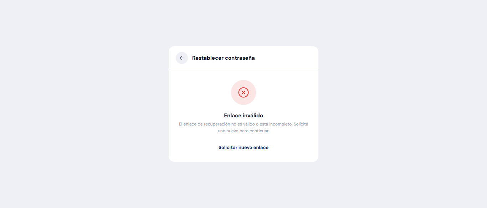

*02_validaciones_de_complejidad*

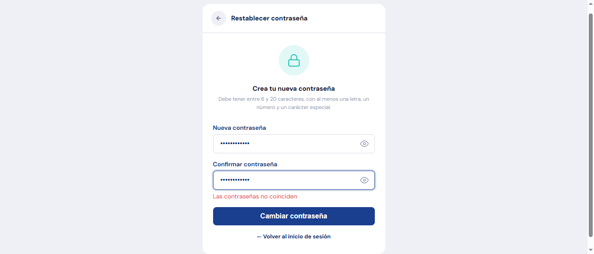

*03_token_invalido*

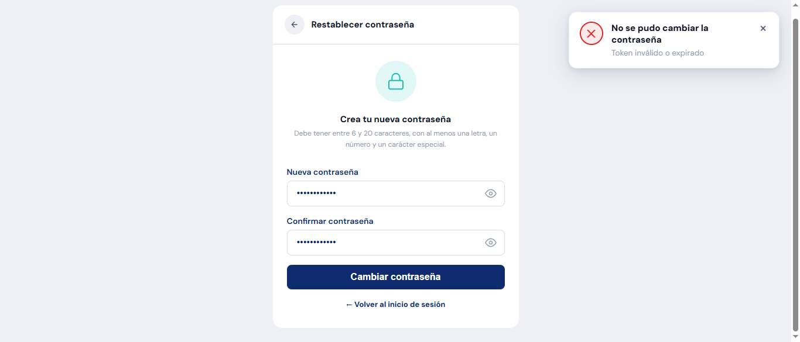

*04_enlace_real_vencido*

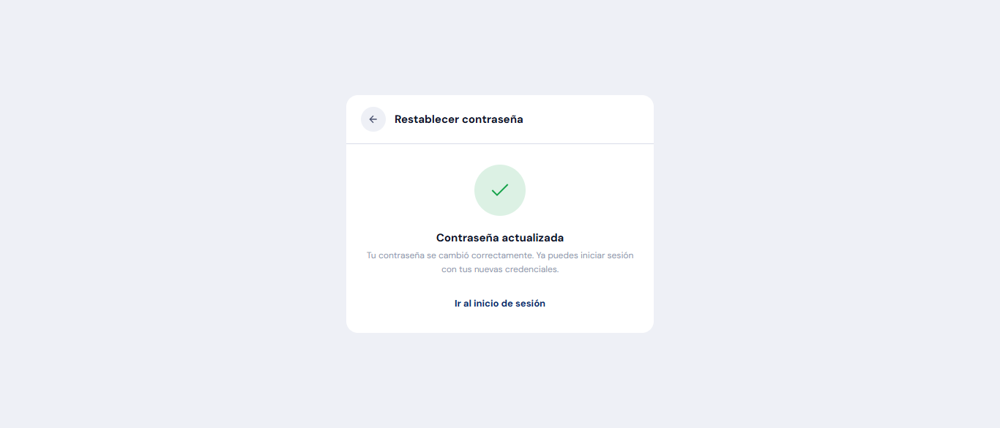

**Historial de intentos:**

| # | Fecha | Resultado | Motivo |
|---|---|---|---|
| 1 | 2026-10-23 13:49 | ❌ FAILED | [TC09] DEFECTO: un enlace de recuperación con más de 5 minutos de emitido sigue siendo válido. Incumple #486/#488. |
| 2 | 2026-10-23 13:54 | ❌ FAILED | [TC09] DEFECTO: un enlace de recuperación con más de 5 minutos de emitido sigue siendo válido. Incumple #486/#488. |

## TC10 – Middleware de autorización: HTTP 401 y 403

`TC10_AZ494_Middleware_401_y_403_segun_token_y_rol` · Azure #494, #489 · HU 1.2.1

**Resultado de la última ejecución:** ✅ PASSED · 2026-10-23 14:14:32 · 0 min 33 s · log `Reports\20261023_141422\TS_TC10\20261023_141422\execution0.log`

**Bitácora de la ejecución:**

1. Configuración completa. Perfil: default
2. [SIN_TOKEN] GET /assessments/all-questions?page=0&page_size=1 -> HTTP 401 {"status":401,"message":"Not authenticated","path":"/assessments/all-questions"} (esperado 401)
3. [SIN_TOKEN] GET /reports/students?page=0&page_size=1 -> HTTP 401 {"status":401,"message":"Not authenticated","path":"/reports/students"} (esperado 401)
4. [SIN_TOKEN] GET /assessments/topics -> HTTP 401 {"status":401,"message":"Not authenticated","path":"/assessments/topics"} (esperado 401)
5. [TOKEN_INVALIDO] GET /assessments/all-questions?page=0&page_size=1 -> HTTP 401 {"status":401,"message":"Invalid authentication credentials","path":"/assessments/all-questions"} (esperado 401)
6. [TOKEN_INVALIDO] GET /reports/students?page=0&page_size=1 -> HTTP 401 {"status":401,"message":"Invalid authentication credentials","path":"/reports/students"} (esperado 401)
7. Sesión de la cuenta ESTUDIANTE reutilizada (https://itmentorsoft.com/student/dashboard)
8. Guía de bienvenida omitida
9. [ESTUDIANTE] GET /assessments/summary?student_id={idPropio}&page=0&page_size=1 -> HTTP 200 {"is_success":true,"message":"Resumen de evaluaciones obtenido exitosamente","total_assessments":1,"assessments":[{"assessment_id":"f603391e3cef458ba0c50db159e7b922","score":0.0,"date_taken":"2026-10-22 02:43","classification":null,"feedback":null}]} (esperado 2xx)
10. [ESTUDIANTE] GET /assessments/all-questions?page=0&page_size=1 -> HTTP 403 {"status":403,"message":"Not enough permissions","path":"/assessments/all-questions"} (esperado 403)
11. [ESTUDIANTE] GET /reports/students?page=0&page_size=1 -> HTTP 403 {"status":403,"message":"Not enough permissions","path":"/reports/students"} (esperado 403)
12. [ESTUDIANTE] GET /reports/students-by-category?category=b%C3%A1sico&page=0&page_size=5 -> HTTP 403 {"status":403,"message":"Not enough permissions","path":"/reports/students-by-category"} (esperado 403)
13. [ESTUDIANTE] vista /admin/dashboard -> /login
14. [ESTUDIANTE] vista /teacher/dashboard -> /login
15. Captura: C:\Users\Jhon Mario R\Documents\Edison\claude\pruebas_aceptacion\ITMentorSoft_Katalon_SQA\Evidencias\TC10\20261023_141455_933_ESTUDIANTE_vista_denegada.png
16. Sesión cerrada (sessionStorage y cookies eliminados)
17. Sesión de la cuenta DOCENTE reutilizada (https://itmentorsoft.com/teacher/dashboard)
18. Guía de bienvenida omitida
19. [DOCENTE] GET /reports/students?page=0&page_size=1 -> HTTP 200 {"is_success":true,"message":"Estudiantes obtenidos exitosamente","result":{"students":[{"student_id":"456c662101ff4db99eaf214c2d30300a","student_name":"Ivan","knowledge_classification":"básico"}],"total_students":10,"page":0}} (esperado 2xx)
20. [DOCENTE] GET /content/ratings/all -> HTTP 403 {"status":403,"message":"Not enough permissions","path":"/content/ratings/all"} (esperado 403)
21. [DOCENTE] vista /admin/dashboard -> /login
22. [DOCENTE] vista /student/dashboard -> /login
23. Captura: C:\Users\Jhon Mario R\Documents\Edison\claude\pruebas_aceptacion\ITMentorSoft_Katalon_SQA\Evidencias\TC10\20261023_141505_694_DOCENTE_vista_denegada.png
24. Sesión cerrada (sessionStorage y cookies eliminados)

**Evidencias:**

*ESTUDIANTE_vista_denegada*

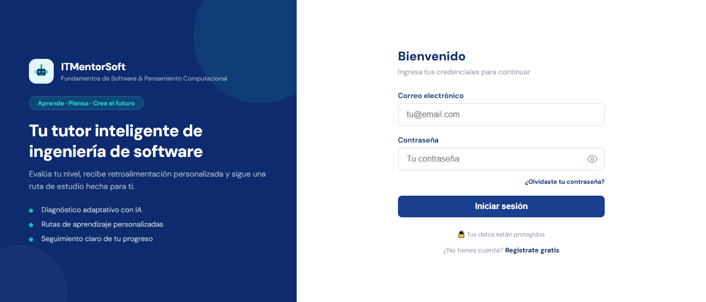

*DOCENTE_vista_denegada*

**Historial de intentos:**

| # | Fecha | Resultado | Motivo |
|---|---|---|---|
| 1 | 2026-10-23 14:13 | ❌ FAILED | [TC10] DEFECTO: [ESTUDIANTE] GET /content/ratings/all respondió HTTP 422 y se esperaba 403. El estudiante no tiene permiso sobre las calificaciones consolidadas (#494). |
| 2 | 2026-10-23 14:14 | ✅ PASSED |  |

## TC11 – Ingreso al módulo de evaluación inicial

`TC11_AZ422_Ingreso_al_modulo_de_evaluacion_inicial` · Azure #422 · HU 2.1.1

**Resultado de la última ejecución:** ❌ FAILED · 2026-10-23 14:32:20 · 0 min 56 s · log `Reports\20261023_143206\TS_TC11\20261023_143206\execution0.log`

**Defectos (FAILED):**

- [TC11] DEFECTO: descartar una evaluación en curso la registra como realizada: el historial pasó de 4 a 6 evaluaciones (nota 0.0, 'Sin clasificar'), lo que altera 'Evaluaciones realizadas' y el promedio. Incumple HU 2.1.1 / CR-006.
- Test Cases/TC11_AZ422_Ingreso_al_modulo_de_evaluacion_inicial FAILED.
Reason:
com.kms.katalon.core.exception.StepFailedException: [TC11] DEFECTO: descartar una evaluación en curso la registra como realizada: el historial pasó de 4 a 6 evaluaciones (nota 0.0, 'Sin clasificar'), lo que altera 'Evaluaciones realizadas' y el promedio. Incumple HU 2.1.1 / CR-006.
	at com.kms.katalon.core.util.KeywordUtil.markFailed(KeywordUtil.java:19)
	at TC11_AZ422_Ingreso_al_modulo_de_evaluacion_inicial.run(TC11_AZ422_Ingreso_al_modulo_de_evaluacion_inicial:127)
	at com.kms.katalon.core.main.ScriptEngine.run(ScriptEngine.java:203)
	at com.kms.katalon.core.main.ScriptEngine.runScriptAsRawText(ScriptEngine.java:115)
	at com.kms.katalon.core.main.TestCaseExecutor.runScript(TestCaseExecutor.java:533)
	at com.kms.katalon.core.main.TestCaseExecutor.doExecute(TestCaseExecutor.java:524)
	at com.kms.katalon.core.main.TestCaseExecutor.processExecutionPhase(TestCaseExecutor.java:503)
	at com.kms.katalon.core.main.TestCaseExecutor.accessMainPhase(TestCaseExecutor.java:495)
	at com.kms.katalon.core.main.TestCaseExecutor.execute(TestCaseExecutor.java:359)
	at com.kms.katalon.core.common.CommonExecutor.accessTestCaseMainPhase(CommonExecutor.java:71)
	at com.kms.katalon.core.main.TestSuiteExecutor.accessTestSuiteMainPhase(TestSuiteExecutor.java:188)
	at com.kms.katalon.core.main.TestSuiteExecutor.execute(TestSuiteExecutor.java:115)
	at com.kms.katalon.core.main.TestCaseMain.startTestSuite(TestCaseMain.java:241)
	at S1023_29.run(S1023_29.groovy:41)
	at java.base/jdk.internal.reflect.DirectMethodHandleAccessor.invoke(DirectMethodHandleAccessor.java:103)

**Bitácora de la ejecución:**

1. Configuración completa. Perfil: default
2. Sesión de la cuenta ESTUDIANTE_EVAL reutilizada (https://itmentorsoft.com/student/dashboard)
3. Guía de bienvenida omitida
4. Captura: C:\Users\Jhon Mario R\Documents\Edison\claude\pruebas_aceptacion\ITMentorSoft_Katalon_SQA\Evidencias\TC11\20261023_143245_755_01_modulo_evaluaciones.png
5. Captura: C:\Users\Jhon Mario R\Documents\Edison\claude\pruebas_aceptacion\ITMentorSoft_Katalon_SQA\Evidencias\TC11\20261023_143247_463_02_seleccion_de_tema.png
6. Temas publicados (API): [Principios de arquitectura y mantenibilidad, Diseño orientado a objetos, Fundamentos y paradigmas, APIs y sistemas distribuidos] | Temas en el selector: [Principios de arquitectura y mantenibilidad, Diseño orientado a objetos, Fundamentos y paradigmas, APIs y sistemas distribuidos]
7. Captura: C:\Users\Jhon Mario R\Documents\Edison\claude\pruebas_aceptacion\ITMentorSoft_Katalon_SQA\Evidencias\TC11\20261023_143257_978_03_formulario_de_preguntas.png
8. Evaluación 1 -> tema mostrado 'Principios de arquitectura y mantenibilidad', Pregunta 1 de 5, panel con 5 preguntas. Pregunta 1: Una función muestra un formulario, calcula descuentos y ejecuta SQL. Identifica esas tres responsabilidades, propone dónde separar cada una y explica un beneficio de la separación.
9. Captura: C:\Users\Jhon Mario R\Documents\Edison\claude\pruebas_aceptacion\ITMentorSoft_Katalon_SQA\Evidencias\TC11\20261023_143307_310_04_segunda_evaluacion.png
10. Evaluación 2 -> Pregunta 1 de 5. Pregunta 1: Una función muestra un formulario, calcula descuentos y ejecuta SQL. Identifica esas tres responsabilidades, propone dónde separar cada una y explica un beneficio de la separación.
11. Captura: C:\Users\Jhon Mario R\Documents\Edison\claude\pruebas_aceptacion\ITMentorSoft_Katalon_SQA\Evidencias\TC11\20261023_143311_131_05_historial_tras_descartar.png
12. Evaluaciones en el historial (API): antes 4, después de iniciar y descartar dos evaluaciones 6
13. Limpieza: evaluación en curso descartada

**Evidencias:**

*01_modulo_evaluaciones*

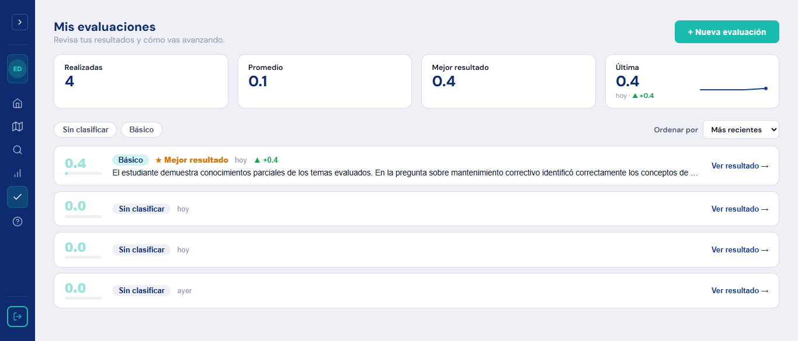

*02_seleccion_de_tema*

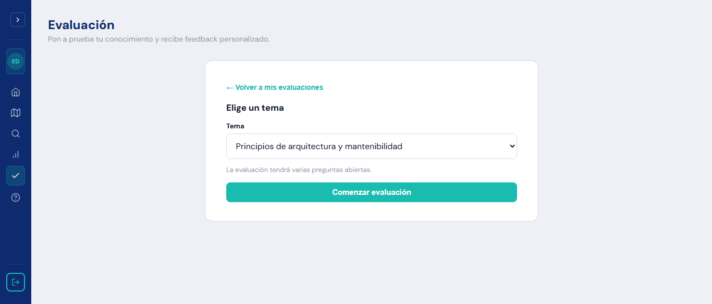

*03_formulario_de_preguntas*

*04_segunda_evaluacion*

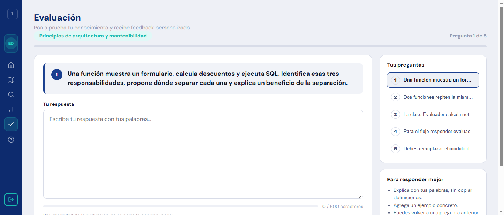

*05_historial_tras_descartar*

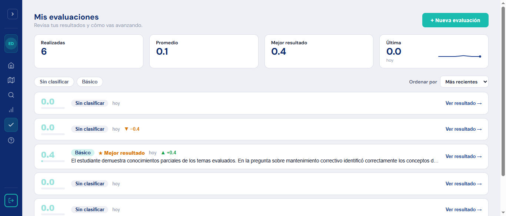

**Historial de intentos:**

| # | Fecha | Resultado | Motivo |
|---|---|---|---|
| 1 | 2026-10-23 14:15 | ✅ PASSED |  |
| 2 | 2026-10-23 14:32 | ❌ FAILED | [TC11] DEFECTO: descartar una evaluación en curso la registra como realizada: el historial pasó de 4 a 6 evaluaciones (nota 0.0, 'Sin clasificar'), lo que altera 'Evaluaciones realizadas' y el promedio. Incumple HU 2.1.1 |

## TC12 – Finalización y retroalimentación de la evaluación

`TC12_AZ435_AZ457_Finalizacion_y_retroalimentacion_de_la_evaluacion` · Azure #435, #457 · HU 2.1.1, 4.2.1

**Resultado de la última ejecución:** ✅ PASSED · 2026-10-23 14:16:40 · 2 min 02 s · log `Reports\20261023_141628\TS_TC12\20261023_141628\execution0.log`

**Bitácora de la ejecución:**

1. Configuración completa. Perfil: default
2. Sesión de la cuenta ESTUDIANTE_EVAL reutilizada (https://itmentorsoft.com/student/dashboard)
3. Guía de bienvenida omitida
4. Evaluación del tema 'Principios de arquitectura y mantenibilidad' con 5 preguntas (historial antes: 3)
5. Pregunta 1 de 5 respondida: Un tutor ya funciona, pero calcula mal una nota. Explica por qué corregirlo es mantenimiento y qué comprobarías después del cambio.
6. Pregunta 2 de 5 respondida: Una función calcularPromedio recibe una lista de notas; para una lista vacía debe devolver 0. Propón una prueba normal y una del caso vacío con resultados esperados, y distingue esta prueba de una prueba de integración.
7. Pregunta 3 de 5 respondida: Para el flujo responder evaluación → guardar → publicar mensaje → mostrar resultado, propone una prueba unitaria, una de integración y una de extremo a extremo. Explica por qué no probarías todo únicamente desde la interfaz.
8. Pregunta 4 de 5 respondida: La clase Evaluador calcula notas, genera informes HTML y configura SMTP. Aplica responsabilidad única: identifica las razones de cambio, propone una separación y explica cómo colaborarían los componentes.
9. Pregunta 5 de 5 respondida: Un equipo de tres personas construye un tutor con baja carga inicial y evaluación LLM lenta. Compara monolito modular y microservicios, recomienda una opción inicial y explica una condición que justificaría revisarla.
10. Captura: C:\Users\Jhon Mario R\Documents\Edison\claude\pruebas_aceptacion\ITMentorSoft_Katalon_SQA\Evidencias\TC12\20261023_141719_713_01_ultima_pregunta_respondida.png
11. Captura: C:\Users\Jhon Mario R\Documents\Edison\claude\pruebas_aceptacion\ITMentorSoft_Katalon_SQA\Evidencias\TC12\20261023_141728_983_02_evaluacion_enviada.png
12. Confirmación de envío: 'Evaluación enviada | Estamos calificando tus respuestas. Te avisaremos aquí y por correo cuando termine.' (ruta /student/dashboard)
13. Evaluación registrada en la API: [assessment_id:6a624a07c8174882a742246bb214783d, classification:básico, date_taken:2026-10-23 19:17, feedback:El estudiante demuestra conocimientos parciales de los temas evaluados. En la pregunta sobre mantenimiento correctivo identificó correctamente los conceptos de corrección de errores, verificación de casos límite y pruebas de regresión, aunque sin ejemplos concretos. Sin embargo, en 4 de 5 preguntas proporcionó contenido irrelevante (nomenclatura, SRP genérico, deuda técnica, refactorización) que no responde lo solicitado. Este patrón sugiere comprensión superficial de los conceptos y dificultad para aplicar el conocimiento específico a cada pregunta., score:0.4]
14. Captura: C:\Users\Jhon Mario R\Documents\Edison\claude\pruebas_aceptacion\ITMentorSoft_Katalon_SQA\Evidencias\TC12\20261023_141841_927_03_resultado_retroalimentacion.png
15. Resultado: nota 0.4, preguntas 5, detalle 5 ítems, retroalimentación: El estudiante demuestra conocimientos parciales de los temas evaluados. En la pregunta sobre mantenimiento correctivo identificó correctamente los conceptos de corrección de errores, verificación de casos límite y pruebas de regresión, aunque sin ejemplos concretos. Sin embargo, en 4 de 5 preguntas
16. Detalle 1: 1 Un tutor ya funciona, pero calcula mal una nota. Explica por qué corregirlo es mantenimiento y qué comprobarías después del cambio. 1 por reforzar 0.0 ▾ TU RESPUESTA Un nombre descriptivo como precioProducto comunica la intención del dato. Quien lee el programa entiende qué representa sin revisar todas sus operaciones, lo que facilita el mantenimiento y reduce errores al modificar el código. Por
17. Detalle 2: 2 Una función calcularPromedio recibe una lista de notas; para una lista vacía debe devolver 0. Propón una prueba normal y una del caso vacío con resultados esperados, y distingue esta prueba de una prueba de integración. 1 por reforzar 2.0 ▾ TU RESPUESTA Corregir un error en un sistema que ya funciona es mantenimiento correctivo: se cambia el código para que cumpla lo esperado sin agregar funcion
18. Detalle 3: 3 Para el flujo responder evaluación → guardar → publicar mensaje → mostrar resultado, propone una prueba unitaria, una de integración y una de extremo a extremo. Explica por qué no probarías todo únicamente desde la interfaz. 1 por reforzar 0.0 ▾ TU RESPUESTA Separar responsabilidades significa que cada módulo o clase tiene un único motivo de cambio. Por ejemplo, separar la lógica de cálculo de n
19. Detalle 4: 4 La clase Evaluador calcula notas, genera informes HTML y configura SMTP. Aplica responsabilidad única: identifica las razones de cambio, propone una separación y explica cómo colaborarían los componentes. 1 por reforzar 0.0 ▾ TU RESPUESTA La deuda técnica son decisiones rápidas que hoy ahorran tiempo pero aumentan el costo de los cambios futuros, como duplicar código o no escribir pruebas. Se ge
20. Detalle 5: 5 Un equipo de tres personas construye un tutor con baja carga inicial y evaluación LLM lenta. Compara monolito modular y microservicios, recomienda una opción inicial y explica una condición que justificaría revisarla. 1 por reforzar 0.0 ▾ TU RESPUESTA La refactorización mejora la estructura interna del código sin cambiar su comportamiento. Antes de refactorizar escribo pruebas que fijen el compo

**Evidencias:**

*01_ultima_pregunta_respondida*

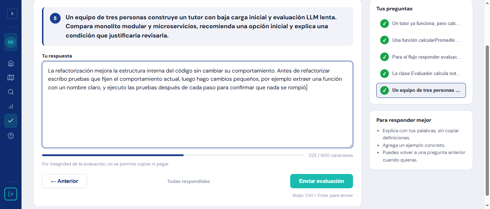

*02_evaluacion_enviada*

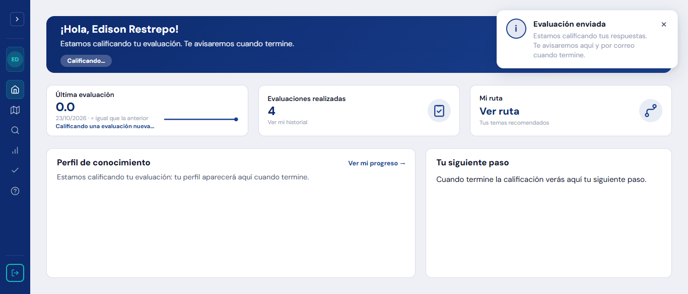

*03_resultado_retroalimentacion*

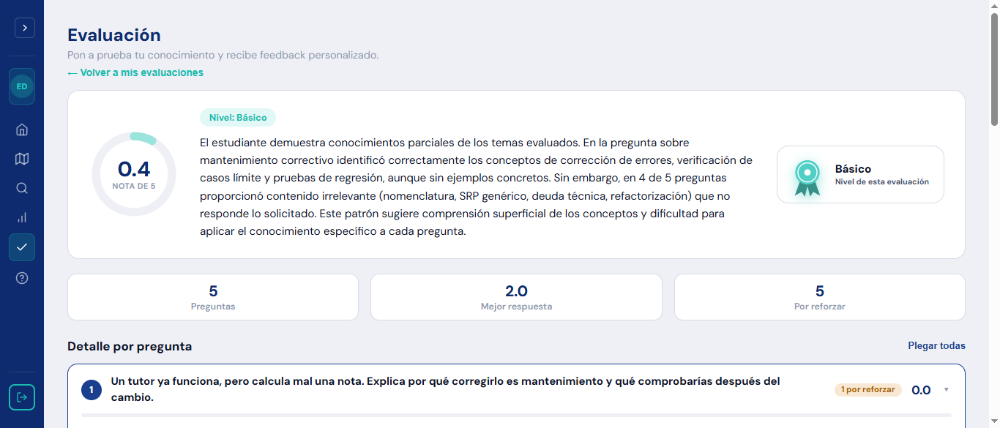

## TC13 – Progreso, perfil de conocimiento y categoría del estudiante

`TC13_AZ426_AZ451_AZ475_Progreso_perfil_y_categoria_del_estudiante` · Azure #426, #451, #459, #465, #475

**Resultado de la última ejecución:** ✅ PASSED · 2026-10-23 14:26:17 · 0 min 35 s · log `Reports\20261023_142600\TS_TC13\20261023_142600\execution0.log`

**Advertencias:**

- [TC13] Observación #451: la interfaz muestra el porcentaje por tema, pero no clasifica las debilidades por severidad (alta < 50 %, media 50-69 %).

**Bitácora de la ejecución:**

1. Configuración completa. Perfil: default
2. Sesión de la cuenta ESTUDIANTE reutilizada (https://itmentorsoft.com/student/dashboard)
3. Guía de bienvenida omitida
4. API: 4 evaluaciones; última calificada: 2026-10-23 19:17, nivel básico, nota 0.4
5. Captura: C:\Users\Jhon Mario R\Documents\Edison\claude\pruebas_aceptacion\ITMentorSoft_Katalon_SQA\Evidencias\TC13\20261023_142644_025_01_panel_estudiante.png
6. Panel: nivel 'Básico', perfil [[tema:Principios de arquitectura y mantenibilidad, pct:8]], última evaluación 0.4 (comparación: '▲ +0.4')
7. Captura: C:\Users\Jhon Mario R\Documents\Edison\claude\pruebas_aceptacion\ITMentorSoft_Katalon_SQA\Evidencias\TC13\20261023_142651_574_02_mi_progreso.png
8. Mi progreso: nivel 'básico', perfil [[tema:Principios de arquitectura y mantenibilidad, pct:8]], gráfica: true, filas de progreso: [Principios de arquitectura y mantenibilidad 8% —]
9. Feedback: El estudiante demuestra conocimientos parciales de los temas evaluados. En la pregunta sobre mantenimiento correctivo identificó correctamente los conceptos de corrección de errores, verificación de casos límite y pruebas de regresión, aunque sin ejemplos concretos. Sin embargo, en 4 de 5 preguntas proporcionó contenido irrelevante (nomenclatura, SRP genérico, deuda técnica, refactorización) que n
10. Áreas de mejora (< 70 %): [Principios de arquitectura y mantenibilidad]

**Evidencias:**

*01_panel_estudiante*

*02_mi_progreso*

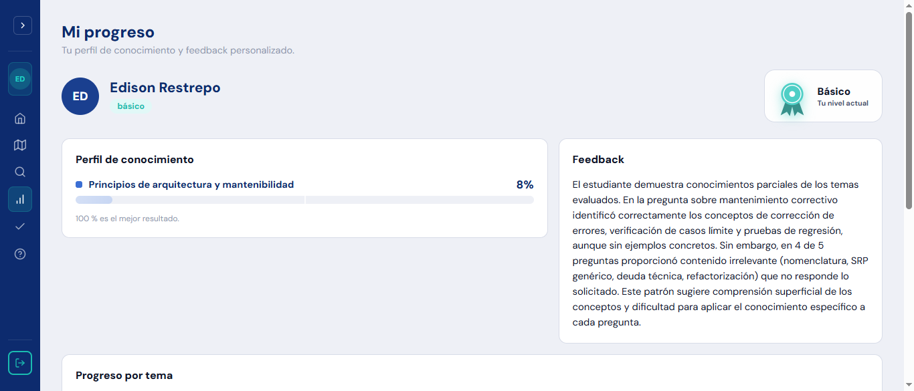

## TC14 – Ruta de aprendizaje y recomendaciones

`TC14_AZ436_AZ446_AZ461_Ruta_de_aprendizaje_y_recomendaciones` · Azure #436, #446, #461

**Resultado de la última ejecución:** ✅ PASSED · 2026-10-23 14:27:31 · 0 min 56 s · log `Reports\20261023_142719\TS_TC14\20261023_142719\execution0.log`

**Advertencias:**

- [TC14] Observación #461: al finalizar un recurso la aplicación no ofrece la evaluación de seguimiento de 10 preguntas aleatorias descrita en Azure.
- [TC14] Observación #446: la aplicación no registra intereses del estudiante; las recomendaciones se basan solo en las debilidades.

**Bitácora de la ejecución:**

1. Configuración completa. Perfil: default
2. Sesión de la cuenta ESTUDIANTE reutilizada (https://itmentorsoft.com/student/dashboard)
3. Guía de bienvenida omitida
4. Áreas de mejora del perfil (< 70 %): [Principios de arquitectura y mantenibilidad]
5. Captura: C:\Users\Jhon Mario R\Documents\Edison\claude\pruebas_aceptacion\ITMentorSoft_Katalon_SQA\Evidencias\TC14\20261023_142814_337_01_ruta_personalizada.png
6. Ruta: temas [Principios de arquitectura y mantenibilidad], 5 recursos, vistos 0, estadísticas [Temas:1, Recursos:5, Vistos:0, Avance general:0]
7. Recurso recomendado: Microsoft Learn: patrón Strangler Fig
8. Recurso recomendado: Microsoft Learn: principios arquitectónicos
9. Recurso recomendado: Microsoft Learn: arquitecturas de aplicaciones web
10. Recurso recomendado: Pro Git: libro abierto en español
11. Recurso recomendado: Microsoft Learn: marco Well-Architected
12. Captura: C:\Users\Jhon Mario R\Documents\Edison\claude\pruebas_aceptacion\ITMentorSoft_Katalon_SQA\Evidencias\TC14\20261023_142821_656_02_recurso_marcado_visto.png
13. Recurso 'Microsoft Learn: patrón Strangler Fig' marcado como visto: aria-pressed=true, estadísticas [Temas:1, Recursos:5, Vistos:1, Avance general:20], avance del tema 0% -> 20%
14. Recurso 'Microsoft Learn: patrón Strangler Fig' desmarcado: estadísticas [Temas:1, Recursos:5, Vistos:0, Avance general:0]

**Evidencias:**

*01_ruta_personalizada*

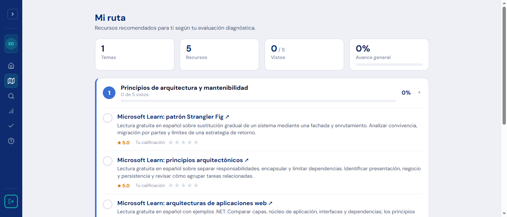

*02_recurso_marcado_visto*

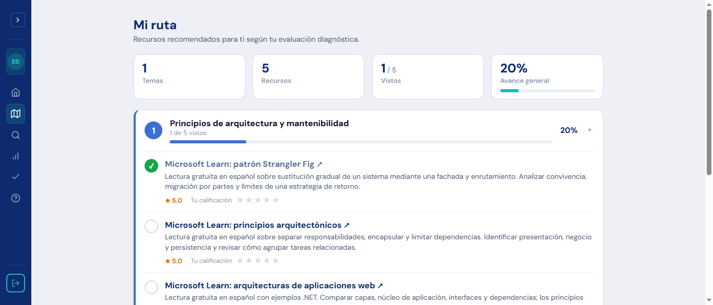

## TC15 – Calificación de recursos recomendados

`TC15_AZ448_Calificacion_de_recursos_recomendados` · Azure #448

**Resultado de la última ejecución:** ✅ PASSED · 2026-10-23 14:30:36 · 0 min 49 s · log `Reports\20261023_143013\TS_TC15\20261023_143013\execution0.log`

**Bitácora de la ejecución:**

1. Configuración completa. Perfil: default
2. Sesión de la cuenta ESTUDIANTE reutilizada (https://itmentorsoft.com/student/dashboard)
3. Guía de bienvenida omitida
4. Recurso elegido: 'Microsoft Learn: principios arquitectónicos' (promedio ★ 5.0); opciones de calificación: 5; calificaciones del usuario antes: 1 (HTTP 200 {"is_success":true,"message":"Calificaciones obtenidas exitosamente","rating_details":[{"content_id":"ae4e5b698abb4a24affddc6e5377c2e0","title":"Microsoft Learn: principios arquitectónicos",")
5. Captura: C:\Users\Jhon Mario R\Documents\Edison\claude\pruebas_aceptacion\ITMentorSoft_Katalon_SQA\Evidencias\TC15\20261023_143105_980_01_calificacion_4.png
6. Calificar con 4 -> 'Calificación actualizada | Tu opinión ayuda a mejorar la ruta.', estrellas marcadas 4
7. Calificar con 5 -> 'Calificación actualizada | Tu opinión ayuda a mejorar la ruta.', estrellas marcadas 5
8. Captura: C:\Users\Jhon Mario R\Documents\Edison\claude\pruebas_aceptacion\ITMentorSoft_Katalon_SQA\Evidencias\TC15\20261023_143115_499_02_calificacion_persistida.png
9. Tras recargar: 5 estrellas marcadas; calificaciones del usuario después: 1 (HTTP 200 {"is_success":true,"message":"Calificaciones obtenidas exitosamente","rating_details":[{"content_id":"ae4e5b698abb4a24affddc6e5377c2e0","title":"Microsoft Learn: principios arquitectónicos","summary":"Lectura gratuita en español sobre separar responsabilidades, encapsular y limitar dependencias. Ide…); promedio ★ 5.0

**Evidencias:**

*01_calificacion_4*

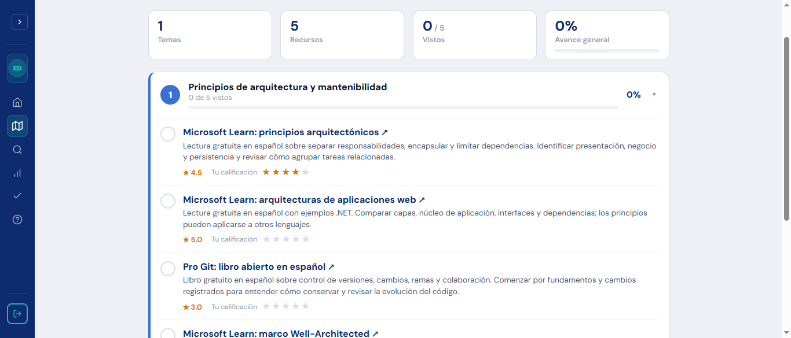

*02_calificacion_persistida*

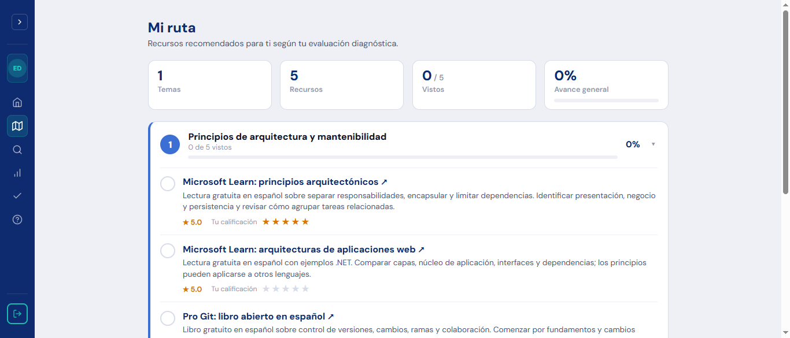

**Historial de intentos:**

| # | Fecha | Resultado | Motivo |
|---|---|---|---|
| 1 | 2026-10-23 14:28 | ✅ PASSED |  |
| 2 | 2026-10-23 14:30 | ✅ PASSED |  |

## TC16 – Acceso por rol a reportes y JSON consolidado

`TC16_AZ450_AZ500_Acceso_por_rol_a_reportes_y_datos_consolidados` · Azure #450, #500

**Resultado de la última ejecución:** ✅ PASSED · 2026-10-23 14:02:30 · 0 min 47 s · log `Reports\20261023_140216\TS_TC16\20261023_140216\execution0.log`

**Bitácora de la ejecución:**

1. Configuración completa. Perfil: default
2. Sesión de la cuenta DOCENTE reutilizada (https://itmentorsoft.com/teacher/dashboard)
3. Guía de bienvenida omitida
4. Captura: C:\Users\Jhon Mario R\Documents\Edison\claude\pruebas_aceptacion\ITMentorSoft_Katalon_SQA\Evidencias\TC16\20261023_140259_505_01_docente_modulo_reportes.png
5. Docente - módulo visible: true, filas en la tabla: 10, API: HTTP 200, total_students=10, registros=10
6. Captura: C:\Users\Jhon Mario R\Documents\Edison\claude\pruebas_aceptacion\ITMentorSoft_Katalon_SQA\Evidencias\TC16\20261023_140302_753_02_docente_reporte_individual.png
7. Docente - reporte individual (/teacher/students/456c662101ff4db99eaf214c2d30300a): visible=true
8. Sesión cerrada (sessionStorage y cookies eliminados)
9. Sesión de la cuenta ESTUDIANTE reutilizada (https://itmentorsoft.com/student/dashboard)
10. Guía de bienvenida omitida
11. Estudiante - vista /teacher/reports -> /login
12. Estudiante - vista /teacher/students/456c662101ff4db99eaf214c2d30300a -> /login
13. Captura: C:\Users\Jhon Mario R\Documents\Edison\claude\pruebas_aceptacion\ITMentorSoft_Katalon_SQA\Evidencias\TC16\20261023_140316_718_03_estudiante_vista_denegada.png
14. Estudiante - API /reports/students?page=0&page_size=5 -> HTTP 403 {"status":403,"message":"Not enough permissions","path":"/reports/students"}
15. Estudiante - API /reports/student_summary?id=456c662101ff4db99eaf214c2d30300a -> HTTP 404 {"status":404,"message":"User not found","path":"/reports/student_summary"}
16. Verificación de acceso a reportes por rol finalizada

**Evidencias:**

*01_docente_modulo_reportes*

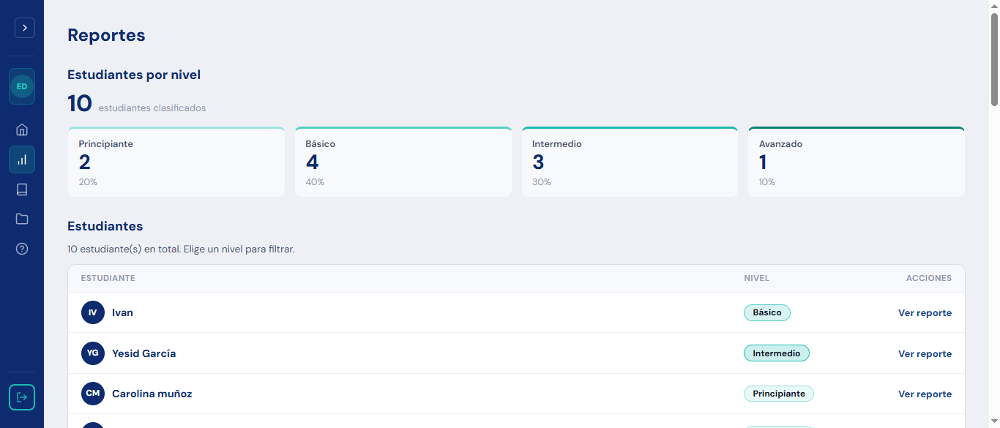

*02_docente_reporte_individual*

*03_estudiante_vista_denegada*

## TC17 – Reportes gráficos, consolidación y filtro por nivel

`TC17_AZ502_AZ476_AZ455_Reportes_graficos_y_filtro_por_nivel` · Azure #502, #418, #476, #455

**Resultado de la última ejecución:** ✅ PASSED · 2026-10-23 14:03:42 · 0 min 48 s · log `Reports\20261023_140331\TS_TC17\20261023_140331\execution0.log`

**Advertencias:**

- [TC17] Observación #476: el dashboard docente no ofrece filtro por rango de fechas para la consolidación por categoría.
- [TC17] Observación #455/#502: no se verificó la vista 'sin datos disponibles' porque el entorno tiene estudiantes clasificados en todos los niveles.

**Bitácora de la ejecución:**

1. Configuración completa. Perfil: default
2. Sesión de la cuenta DOCENTE reutilizada (https://itmentorsoft.com/teacher/dashboard)
3. Guía de bienvenida omitida
4. API: 10 estudiantes, por nivel [Principiante:2, Básico:4, Intermedio:3, Avanzado:1]
5. Captura: C:\Users\Jhon Mario R\Documents\Edison\claude\pruebas_aceptacion\ITMentorSoft_Katalon_SQA\Evidencias\TC17\20261023_140401_797_01_dashboard_docente.png
6. Dashboard: Estudiantes activos=10, barras por categoría=[4, 3, 2, 1]
7. Captura: C:\Users\Jhon Mario R\Documents\Edison\claude\pruebas_aceptacion\ITMentorSoft_Katalon_SQA\Evidencias\TC17\20261023_140407_330_02_reporte_por_nivel.png
8. Reportes: total clasificados=10, por nivel=[Principiante:2, Básico:4, Intermedio:3, Avanzado:1], suma de porcentajes=100%, gráficos de torta=3
9. Filtro 'Principiante': 2 filas (tarjeta: 2), conteo '2 estudiante(s) en el nivel Principiante'
10. Filtro 'Básico': 4 filas (tarjeta: 4), conteo '4 estudiante(s) en el nivel Básico'
11. Captura: C:\Users\Jhon Mario R\Documents\Edison\claude\pruebas_aceptacion\ITMentorSoft_Katalon_SQA\Evidencias\TC17\20261023_140415_732_03_filtro_basico.png
12. Filtro 'Intermedio': 3 filas (tarjeta: 3), conteo '3 estudiante(s) en el nivel Intermedio'
13. Filtro 'Avanzado': 1 filas (tarjeta: 1), conteo '1 estudiante(s) en el nivel Avanzado'
14. Captura: C:\Users\Jhon Mario R\Documents\Edison\claude\pruebas_aceptacion\ITMentorSoft_Katalon_SQA\Evidencias\TC17\20261023_140429_302_04_sin_filtro.png
15. Sin filtro: 10 filas; conteo '10 estudiante(s) en total. Elige un nivel para filtrar.'

**Evidencias:**

*01_dashboard_docente*

*02_reporte_por_nivel*

*03_filtro_basico*

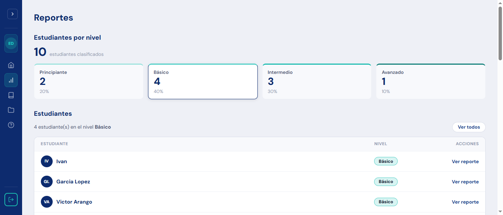

*04_sin_filtro*

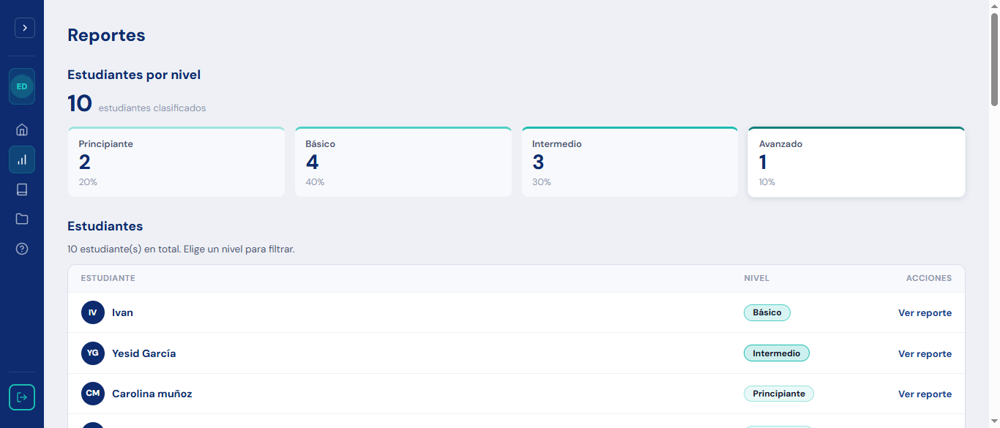

## TC18 – Reportes de recursos y del banco de preguntas

`TC18_AZ440_AZ444_Reportes_de_recursos_y_banco_de_preguntas` · Azure #440, #444

**Resultado de la última ejecución:** ✅ PASSED · 2026-10-23 14:04:56 · 1 min 30 s · log `Reports\20261023_140446\TS_TC18\20261023_140446\execution0.log`

**Advertencias:**

- [TC18] Observación #440: la interfaz no resalta los recursos con promedio menor a 3.5 ni muestra el porcentaje de recursos con baja valoración.
- [TC18] Observación #444: no existe un reporte consolidado de debilidades por tema (promedio < 70 % y 'debilidad común' con ≥ 30 % de estudiantes); el docente solo ve el progreso por tema de cada estudiante.

**Bitácora de la ejecución:**

1. Configuración completa. Perfil: default
2. Sesión de la cuenta DOCENTE reutilizada (https://itmentorsoft.com/teacher/dashboard)
3. Guía de bienvenida omitida
4. Captura: C:\Users\Jhon Mario R\Documents\Edison\claude\pruebas_aceptacion\ITMentorSoft_Katalon_SQA\Evidencias\TC18\20261023_140528_773_01_reporte_recursos.png
5. Recursos - Recursos por nivel: total 60, segmentos [8, 13, 18, 21]
6. Recursos - Recursos por tema: total 61, segmentos [17, 15, 15, 14]
7. Tema 'Principios de arquitectura y mantenibilidad' - peor valorados: [3.0, 3.0, 5.0, 5.0, 5.0] | mejor valorados: [5.0, 5.0, 5.0, 3.0, 3.0]
8. Tema 'Diseño orientado a objetos' - peor valorados: [] | mejor valorados: []
9. Tema 'Fundamentos y paradigmas' - peor valorados: [3.0, 4.0, 4.0, 4.0, 4.5] | mejor valorados: [4.5, 4.0, 4.0, 4.0, 3.0]
10. Tema 'APIs y sistemas distribuidos' - peor valorados: [3.0, 3.0, 3.0] | mejor valorados: [3.0, 3.0, 3.0]
11. Captura: C:\Users\Jhon Mario R\Documents\Edison\claude\pruebas_aceptacion\ITMentorSoft_Katalon_SQA\Evidencias\TC18\20261023_140615_043_02_mejor_y_peor_valorados.png
12. Captura: C:\Users\Jhon Mario R\Documents\Edison\claude\pruebas_aceptacion\ITMentorSoft_Katalon_SQA\Evidencias\TC18\20261023_140615_954_03_reporte_banco_preguntas.png
13. Preguntas - Preguntas por dificultad: total 60, segmentos [28, 16, 16]
14. Preguntas - Preguntas por estado: total 60, segmentos [60, 0, 0]
15. Preguntas - Preguntas por categoría: total 60, segmentos [15, 15, 15, 15]
16. Captura: C:\Users\Jhon Mario R\Documents\Edison\claude\pruebas_aceptacion\ITMentorSoft_Katalon_SQA\Evidencias\TC18\20261023_140625_672_04_reporte_individual_por_tema.png
17. Reporte individual: ← Volver a Reportes IV Ivan básico 1 evaluación(es) realizada(s) Básico Tu nivel actual Perfil de conocimiento Fundamentos y paradigmas 48% 100 % es el mejor resultado. Feedback Demuestra comprensión de conceptos fundamentales como tipos de datos, condicionales y funciones puras vs efectos laterales. Identifica correctamente la diferencia string/integer, el caso frontera en comparaciones y propone separación cálculo-persistencia. Sin embargo, dos respuestas son no académicas y no abordan pregunt

**Evidencias:**

*01_reporte_recursos*

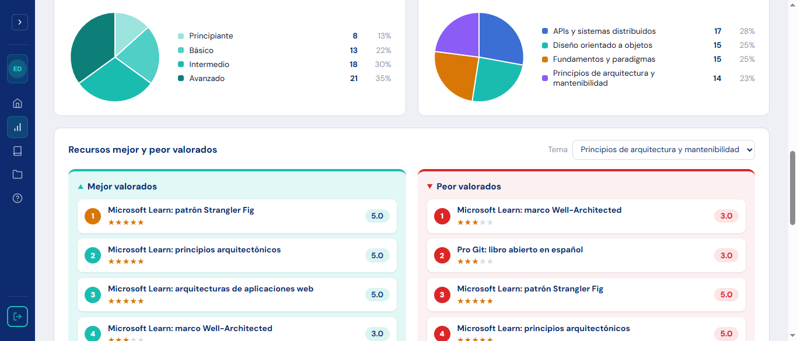

*02_mejor_y_peor_valorados*

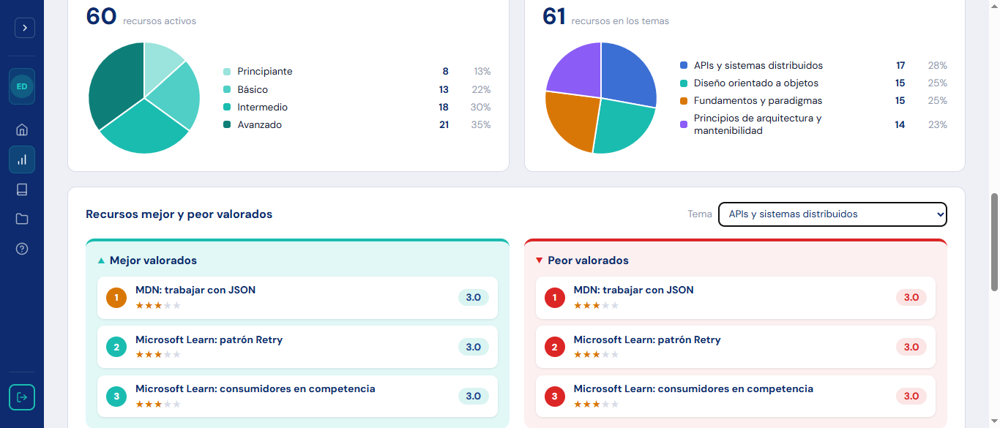

*03_reporte_banco_preguntas*

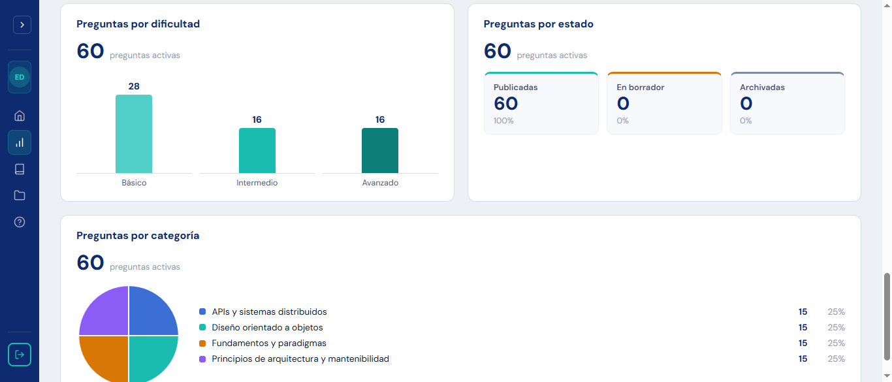

*04_reporte_individual_por_tema*

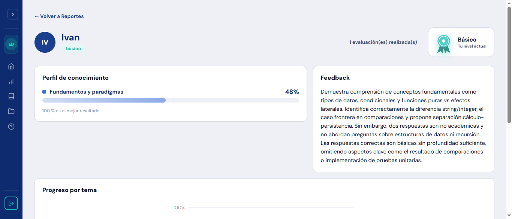

## TC19 – Gestión de recursos: validaciones y consulta

`TC19_AZ430_Gestion_de_recursos_validaciones_y_consulta` · Azure #430

**Resultado de la última ejecución:** ✅ PASSED · 2026-10-23 14:10:04 · 1 min 02 s · log `Reports\20261023_140943\TS_TC19\20261023_140943\execution0.log`

**Bitácora de la ejecución:**

1. Configuración completa. Perfil: default
2. Sesión de la cuenta DOCENTE reutilizada (https://itmentorsoft.com/teacher/dashboard)
3. Guía de bienvenida omitida
4. Formulario de nuevo recurso: × Nuevo recurso Título (5–150) Descripción (10–300) URL (https://…) Temas relacionados (marca al menos 1) Selecciona uno o más temas ▾ Crear recurso
5. Captura: C:\Users\Jhon Mario R\Documents\Edison\claude\pruebas_aceptacion\ITMentorSoft_Katalon_SQA\Evidencias\TC19\20261023_141029_050_01_campos_vacios.png
6. Guardar con campos vacíos -> errores: [Requerido, Requerido, Requerido, Selecciona al menos un tema]
7. Campo 'title' con 3 caracteres -> 'Mínimo 5 caracteres'
8. Campo 'title' con 151 caracteres -> 'Máximo 150 caracteres'
9. Campo 'description' con 5 caracteres -> 'Mínimo 10 caracteres'
10. Campo 'description' con 301 caracteres -> 'Máximo 300 caracteres'
11. Campo 'url' con 26 caracteres -> 'Debe empezar con https://'
12. Captura: C:\Users\Jhon Mario R\Documents\Edison\claude\pruebas_aceptacion\ITMentorSoft_Katalon_SQA\Evidencias\TC19\20261023_141041_997_02_validaciones_longitud_y_url.png
13. Guardar con datos inválidos -> modal abierto: true, notificación: 'null'
14. Filtro de categoría 'principiante': 8 recursos en la página; categorías distintas: []
15. Filtro de categoría 'básico': 10 recursos en la página; categorías distintas: []
16. Filtro de categoría 'intermedio': 10 recursos en la página; categorías distintas: []
17. Filtro de categoría 'avanzado': 10 recursos en la página; categorías distintas: []
18. Captura: C:\Users\Jhon Mario R\Documents\Edison\claude\pruebas_aceptacion\ITMentorSoft_Katalon_SQA\Evidencias\TC19\20261023_141058_237_03_filtro_por_categoria.png
19. Búsqueda por título 'Pro Git: libro abierto en español' -> [Pro Git: libro abierto en español]
20. Captura: C:\Users\Jhon Mario R\Documents\Edison\claude\pruebas_aceptacion\ITMentorSoft_Katalon_SQA\Evidencias\TC19\20261023_141105_540_04_edicion_recurso.png
21. Edición abierta: título cargado 'Pro Git: libro abierto en español', botón 'Guardar cambios'

**Evidencias:**

*01_campos_vacios*

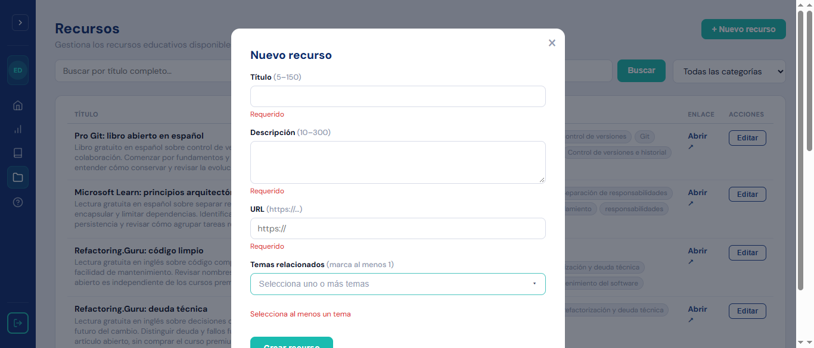

*02_validaciones_longitud_y_url*

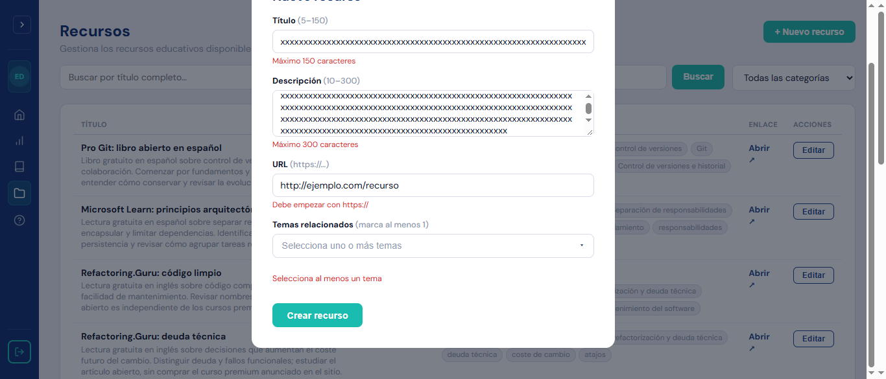

*03_filtro_por_categoria*

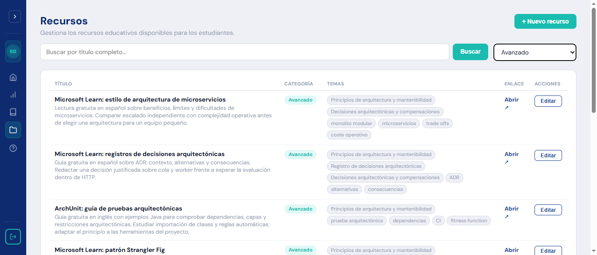

*04_edicion_recurso*

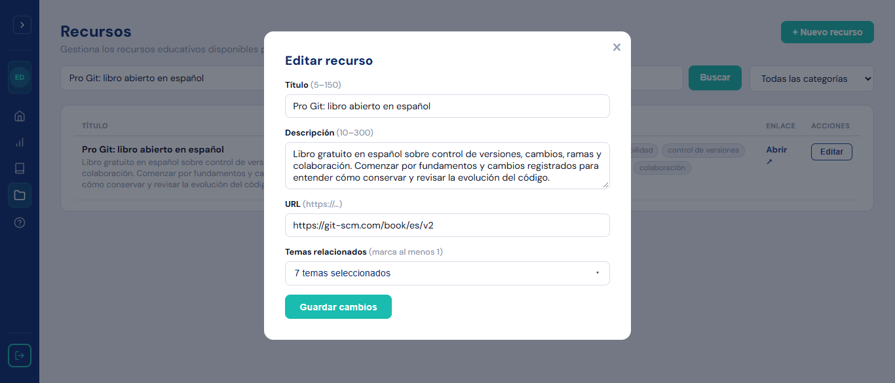

**Historial de intentos:**

| # | Fecha | Resultado | Motivo |
|---|---|---|---|
| 1 | 2026-10-23 14:07 | ❌ FAILED | [TC19] DEFECTO: con campos vacíos se esperaban errores en título, descripción, URL y temas, y se obtuvieron [Selecciona al menos un tema] (#430). |
| 2 | 2026-10-23 14:10 | ✅ PASSED |  |

## TC20 – Banco de preguntas: paginación, filtros y versiones

`TC20_AZ468_Banco_de_preguntas_paginacion_filtros_y_versiones` · Azure #468, #499

**Resultado de la última ejecución:** ✅ PASSED · 2026-10-23 14:11:39 · 1 min 15 s · log `Reports\20261023_141128\TS_TC20\20261023_141128\execution0.log`

**Advertencias:**

- [TC20] Observación #468: el banco pagina de a 10 preguntas; Azure exige exactamente 20 por página.
- [TC20] Alcance #468: la persistencia del CRUD (crear, editar, desactivar) no se automatizó para no alterar el banco que usan las evaluaciones reales.

**Bitácora de la ejecución:**

1. Configuración completa. Perfil: default
2. Sesión de la cuenta DOCENTE reutilizada (https://itmentorsoft.com/teacher/dashboard)
3. Guía de bienvenida omitida
4. Captura: C:\Users\Jhon Mario R\Documents\Edison\claude\pruebas_aceptacion\ITMentorSoft_Katalon_SQA\Evidencias\TC20\20261023_141201_958_01_banco_pagina_1.png
5. Banco: 60 preguntas, 10 filas en la página 1, 6 páginas
6. Página 2: 10 preguntas; Página 2 de 6
7. Filtro Por dificultad = 'básico': 28 preguntas en la página; valores distintos: []
8. Filtro Por dificultad = 'intermedio': 16 preguntas en la página; valores distintos: []
9. Filtro Por dificultad = 'avanzado': 16 preguntas en la página; valores distintos: []
10. Captura: C:\Users\Jhon Mario R\Documents\Edison\claude\pruebas_aceptacion\ITMentorSoft_Katalon_SQA\Evidencias\TC20\20261023_141219_199_02_filtro_dificultad.png
11. Filtro Por categoría = 'Principios de arquitectura y mantenibilidad': 15 preguntas en la página; valores distintos: []
12. Filtro Por categoría = 'Diseño orientado a objetos': 15 preguntas en la página; valores distintos: []
13. Filtro Por categoría = 'Fundamentos y paradigmas': 15 preguntas en la página; valores distintos: []
14. Filtro Por categoría = 'APIs y sistemas distribuidos': 15 preguntas en la página; valores distintos: []
15. Captura: C:\Users\Jhon Mario R\Documents\Edison\claude\pruebas_aceptacion\ITMentorSoft_Katalon_SQA\Evidencias\TC20\20261023_141236_576_03_filtro_categoria.png
16. Captura: C:\Users\Jhon Mario R\Documents\Edison\claude\pruebas_aceptacion\ITMentorSoft_Katalon_SQA\Evidencias\TC20\20261023_141245_281_04_detalle_y_versiones.png
17. Detalle visible: true; historial de versiones visible: true (Ocultar versiones v1 Publicada · Última Estás viendo esta Dos workers reciben el mismo assessment_id; ambos comprueban que no hay resultado y luego insertan. Explica la carrera, propone un control atómico y describe qué harías si un worker cae antes de completar el procesamiento.)
18. Captura: C:\Users\Jhon Mario R\Documents\Edison\claude\pruebas_aceptacion\ITMentorSoft_Katalon_SQA\Evidencias\TC20\20261023_141255_022_05_formulario_pregunta_invalida.png
19. Crear pregunta inválida -> 12 errores ([Mínimo 20 caracteres, Requerido]), notificación 'null'

**Evidencias:**

*01_banco_pagina_1*

*02_filtro_dificultad*

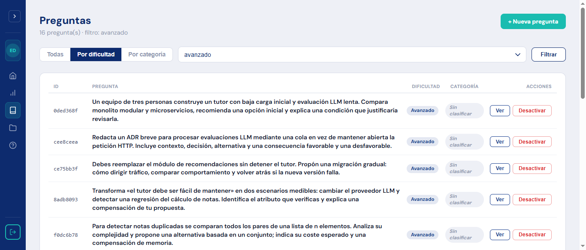

*03_filtro_categoria*

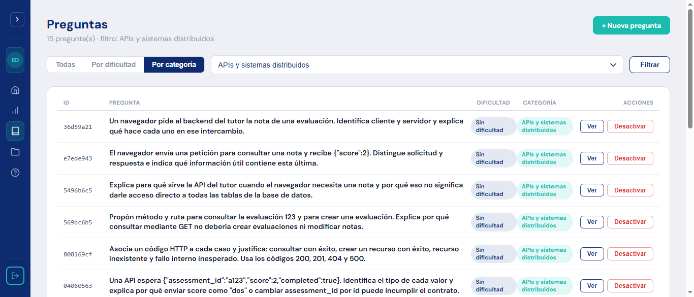

*04_detalle_y_versiones*

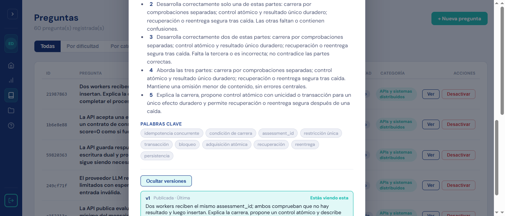

*05_formulario_pregunta_invalida*

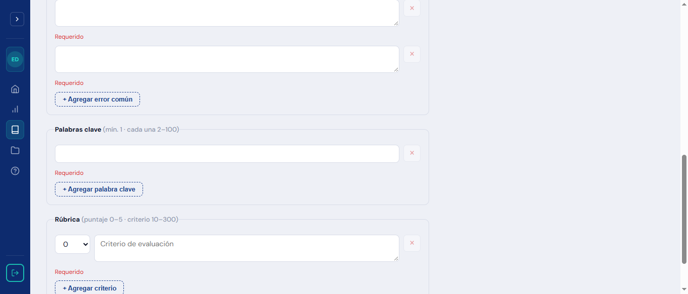

## Ajustes realizados entre ejecuciones

### Forma de ejecución

- Los casos se ejecutaron uno a uno desde Katalon Studio 11.6 mediante su servidor MCP local (StudioAssist, `executeTest` sobre las suites `TS_TC01` a `TS_TC20`), con el perfil `default` y Chrome. La ejecución por consola (`katalonc`) no fue posible: exige licencia de Runtime Engine o API key.
- Código OTP del **Estudiante**: se leyó del correo `edisonestival@gmail.com` (remitente `itmentorsoft@…brevosend.com`) y se entregó a la prueba por `Evidencias/otp/codigo.txt`. Código OTP del **Docente**: lo escribió el tester en el navegador (el buzón `@correo.itm.edu.co` no estaba accesible). El código vence a los 2 minutos.
- **Reutilización de sesión**: después de un login con OTP, el keyword `Autenticacion` guarda sessionStorage y cookies en `Evidencias/sesiones/` (no versionada) y los casos siguientes la restauran. Los casos que prueban el login en sí (TC04, TC07) no la usan. Así un ciclo completo pide un OTP por rol.
- Las contraseñas se configuraron como variables de entorno de usuario (`ITM_PWD_ESTUDIANTE`, `ITM_PWD_DOCENTE`); no están en el proyecto.
- Los casos de Azure se leyeron en modo de solo lectura (43 casos de prueba). No se modificó nada en Azure DevOps. Clasificación y trazabilidad en `Documentacion/Inventario_Casos_Azure.md`.

### Ajustes realizados (primera y segunda ronda)

- **Data Files**: el separador CSV estaba como `,` y Katalon espera `COMMA` (afectaba a TC01-TC03).
- **Guía de bienvenida**: la aplicación abre una guía (`app-guide-dialog`) la primera vez que un usuario entra desde un navegador; su fondo interceptaba los clics. El keyword `Autenticacion.omitirGuia` pulsa **Omitir** después del login.
- **Campos de formulario**: Angular copia el `id` estático del campo también al componente anfitrión (`<app-input id="email">`), por lo que `#email` no era interactuable. El objeto `Comun/txt_Campo` busca solo `input`, `textarea` y `select`.
- **TC04**: la primera versión leía la alerta del formulario (que es una sugerencia de registro) en lugar del mensaje de error; la verificación pasó por una razón equivocada. Se corrigió para leer la notificación ("Correo o contraseña incorrectos.") y comparar también la alerta.
- **TC09**: el primer intento usó el enlace real de recuperación 4 min 39 s después de emitido (error de tiempo del tester), así que el resultado FAILED de ese intento **no es válido**. Se corrigió la prueba para que espere a que el enlace supere los 5 minutos y se repitió con un enlace nuevo. En ambos casos se envió la contraseña actual, por lo que la contraseña de la cuenta no cambió.
- **TC10**: la fila que esperaba 403 del estudiante en `/content/ratings/all` partía de un supuesto errado: ese endpoint es el que usa el estudiante para ver sus propias calificaciones (responde 422 porque falta `user_id`). Se reemplazó por un endpoint exclusivo del docente (`/reports/students-by-category`).
- **TC15**: la verificación de duplicados no reconocía la estructura del JSON (`rating_details`); se corrigió y se repitió.
- **TC19**: los errores de campo del formulario de recursos usan la clase `res__field-error` (no `res__error`).
- **TC11**: se agregó la verificación de que una evaluación descartada no quede registrada como realizada (ver defecto D4).
- **Suites**: `TS_TC01`…`TS_TC20` (una por caso) y `TS_Regresion_Completa` (los 20 en orden de ejecución recomendado).

### Defectos encontrados

- **D1 - Vigencia del token de acceso (TC07, #485)**: el JWT de acceso vence a los **60 minutos** (claim `exp` = 3597 s tras el login) para Estudiante y Docente; #485 exige 15 minutos. La cookie `access_token` sí es HttpOnly y Secure y la redirección por rol es correcta.
- **D2 - Vigencia del enlace de recuperación (TC09, #486/#488)**: un enlace usado **357 s (≈ 6 min)** después de emitido sigue siendo válido ("Contraseña actualizada"). La pantalla y Azure indican 5 minutos; el correo dice "El enlace expirará en 30 minutos". Las tres fuentes no coinciden.
- **D3 - Texto del correo de recuperación (TC08)**: el correo informa 30 minutos de vigencia mientras la interfaz informa 5 minutos (inconsistencia de información al usuario).
- **D4 - Evaluaciones descartadas quedan registradas (TC11, HU 2.1.1 / CR-006)**: al descartar una evaluación en curso, el sistema la guarda como evaluación realizada con nota 0.0 y "Sin clasificar". Infla "Evaluaciones realizadas", baja el promedio y altera la comparación con la evaluación anterior (el panel muestra "▲ +0.4" comparando con una evaluación descartada). Las ejecuciones de TC03 y TC11 dejaron este tipo de registros en el historial del estudiante de pruebas.

### Observaciones (diferencias entre el requisito de Azure y la aplicación)

- **TC02 (#466)**: al Estudiante se le niega el acceso (API 403 y redirección a `/login`) pero no se muestra un mensaje de autorización.
- **TC03 (#434)**: la interfaz permite volver con "Anterior" y saltar entre preguntas; Azure dice "sin permitir saltar ni retroceder".
- **TC04 (#483)**: el mensaje genérico es "Correo o contraseña incorrectos." (Azure: "Usuario o contraseña incorrectas"); es genérico y no revela el dato.
- **TC07 (#485)**: además de la cookie HttpOnly, el frontend guarda una copia del JWT en `sessionStorage`, accesible desde JavaScript.
- **TC13 (#451)**: el perfil muestra el porcentaje por tema pero no clasifica la severidad (alta < 50 %, media 50-69 %).
- **TC14 (#461, #446)**: no existe la evaluación de seguimiento de 10 preguntas al finalizar un recurso ni el registro de intereses del estudiante.
- **TC17 (#476, #455, #502)**: no hay filtro por rango de fechas; la vista "sin datos disponibles" no se puede provocar con los datos reales.
- **TC18 (#440, #444)**: no se resaltan los recursos con promedio < 3.5 y no existe el consolidado de "debilidad común" por tema.
- **TC20 (#468)**: el banco de preguntas pagina de a **10** (Azure exige 20); las vistas filtradas muestran todos los resultados sin paginar. La persistencia del CRUD no se automatizó para no alterar el banco real.
- **TC01 (#496)**: el control positivo por API del Estudiante A depende de que tenga resultados; tras TC12 el estudiante de pruebas ya tiene una evaluación calificada.
- Casos de Azure no automatizables en este entorno (sin cuenta de Administrador, internos del modelo de ML o funcionalidades inexistentes): #438, #442, #469, #471, #472, #473, #477, #493, #497. Detalle en `Inventario_Casos_Azure.md`.

### Efectos en los datos del entorno de pruebas

- TC12 envió una evaluación completa del estudiante de pruebas (nivel asignado: básico); TC15 dejó la calificación 5 en el recurso "Microsoft Learn: principios arquitectónicos" (promedio 5.0, sin cambio); TC14 marcó y desmarcó un recurso (sin cambio neto).
- TC03 y TC11 dejaron evaluaciones descartadas en el historial por el defecto D4.
- No se crearon cuentas, recursos ni preguntas, y no se cambiaron contraseñas.
