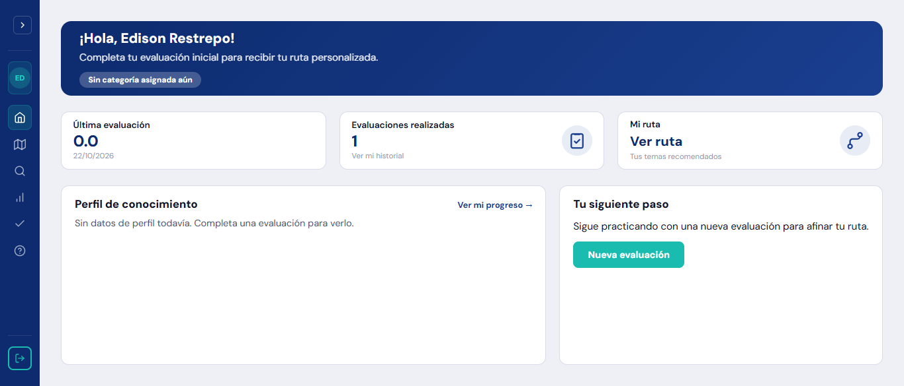
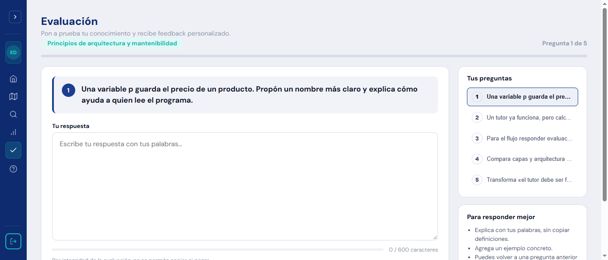
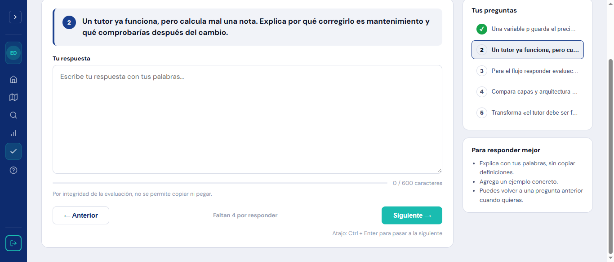
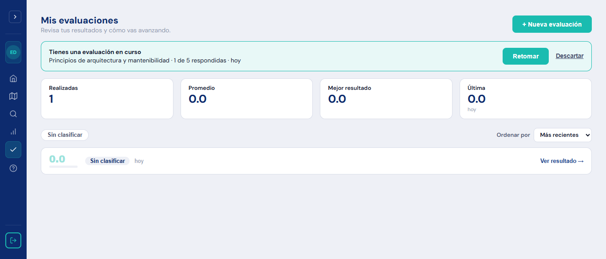
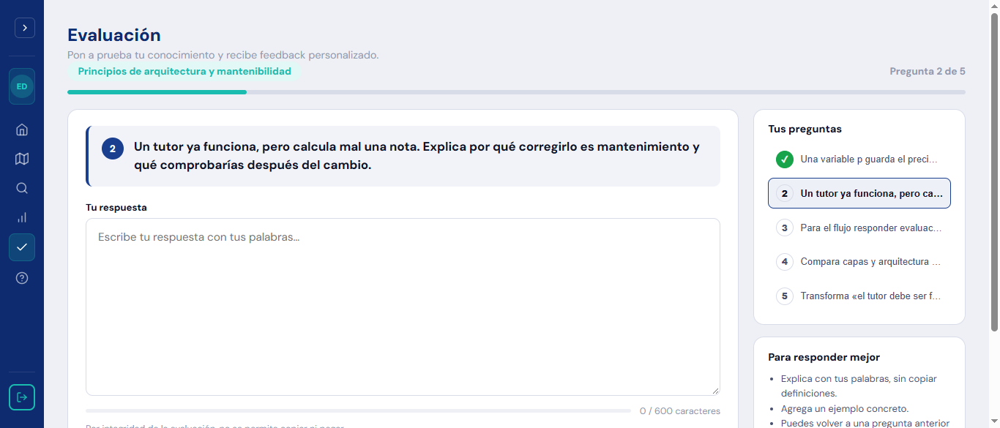
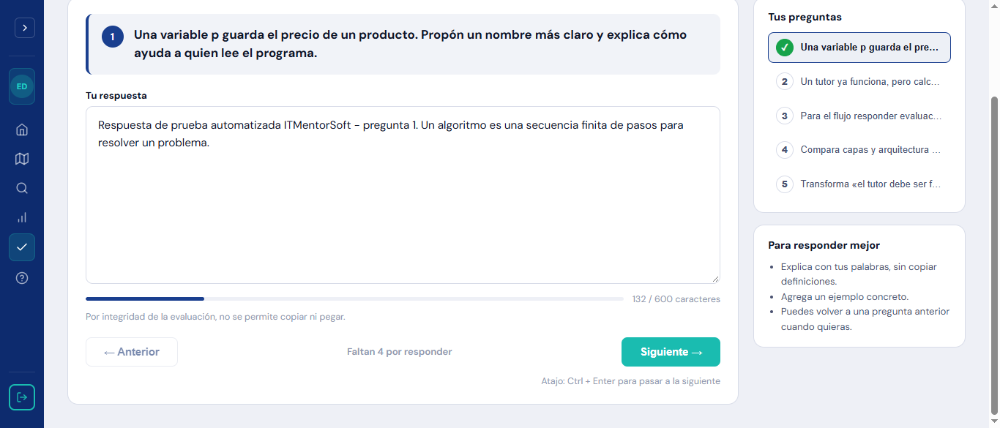

# Informe de ejecución de pruebas – ITMentorSoft

Generado: 2026-10-21 21:53 · Aplicación: https://itmentorsoft.com · Herramienta: Katalon Studio 11.6 · Perfil: `default` · Navegador: Chrome

Fuente: logs de Katalon en `Reports/` y evidencias del keyword `Evidencia`. Las capturas de la última ejecución de cada caso se copiaron a `Documentacion/Evidencias_Ejecucion/`. El reporte visual está en `Documentacion/Reporte_Pruebas.html`.

## Resumen

| Caso | Descripción | Origen | Resultado | Fecha | Duración | Intentos |
|---|---|---|---|---|---|---|
| TC01 | Aislamiento de datos académicos entre estudiantes | Azure #496 · HU 1.2.2 CA2, CA3 · Riesgo RH01 / R03 | ✅ PASSED | 2026-10-21 21:46 | 2 min 02 s | 1 |
| TC02 | Restricción de acceso por rol a la administración de evaluaciones | Azure #466 · HU 2.1.3 CA1 · Riesgo RH02 / R03 + R01 | ✅ PASSED | 2026-10-21 21:49 | 2 min 15 s | 1 |
| TC03 | Evaluación secuencial y persistencia de respuestas | Azure #434 · HU 2.1.1 CA2, CA3, CR-006 · Riesgo RH03 | ✅ PASSED | 2026-10-21 21:42 | 1 min 33 s | 3 |

Convención: **PASSED** = se cumplieron todas las verificaciones (las advertencias son observaciones sobre el requisito); **FAILED** = defecto funcional; **ERROR** = la prueba no se pudo completar (configuración, login/OTP o precondición).

## TC01 – Aislamiento de datos académicos entre estudiantes

`TC01_HU122_Aislamiento_datos_academicos_entre_estudiantes` · Azure #496 · HU 1.2.2 CA2, CA3 · Riesgo RH01 / R03

**Resultado de la última ejecución:** ✅ PASSED · 2026-10-21 21:46:24 · 2 min 02 s · log `Reports\20261021_214606\TS_TC01\20261021_214606\execution0.log`

**Bitácora de la ejecución:**

1. Configuración completa. Perfil: default
2. ACCIÓN MANUAL: escriba en el navegador el código OTP enviado a edisonrestrepo68991@correo.itm.edu.co y pulse 'Verificar e ingresar' (espera máxima 180 s).
3. Sesión iniciada con la cuenta DOCENTE (https://itmentorsoft.com/teacher/dashboard)
4. Guía de bienvenida omitida
5. Lista de estudiantes (sesión Docente): HTTP 200
6. Sesión cerrada (sessionStorage y cookies eliminados)
7. ACCIÓN MANUAL: escriba en el navegador el código OTP enviado a edisonestival@gmail.com y pulse 'Verificar e ingresar' (espera máxima 180 s).
8. Sesión iniciada con la cuenta ESTUDIANTE_A (https://itmentorsoft.com/student/dashboard)
9. Guía de bienvenida omitida
10. Estudiante A: 0e286d5678b3455a83be2bba59a8f7ab | Estudiante B: 456c662101ff4db99eaf214c2d30300a
11. Captura: C:\Users\Jhon Mario R\Documents\Edison\claude\pruebas_aceptacion\ITMentorSoft_Katalon_SQA\Evidencias\TC01\20261021_214821_810_01_resultados_propios.png
12. Control positivo - datos propios por API: HTTP 404 {"status":404,"message":"Resumen del estudiante no encontrado","path":"/reports/student_summary"}
13. Solicitud de datos ajenos /reports/student_summary?id=456c662101ff4db99eaf214c2d30300a -> HTTP 404 {"status":404,"message":"User not found","path":"/reports/student_summary"}
14. Solicitud de datos ajenos /assessments/summary?student_id=456c662101ff4db99eaf214c2d30300a&page=0&page_size=20 -> HTTP 404 {"status":404,"message":"User not found","path":"/assessments/summary"}
15. Solicitud de vista ajena: https://itmentorsoft.com/teacher/students/456c662101ff4db99eaf214c2d30300a
16. Captura: C:\Users\Jhon Mario R\Documents\Edison\claude\pruebas_aceptacion\ITMentorSoft_Katalon_SQA\Evidencias\TC01\20261021_214825_209_02_solicitud_resultados_estudiante_B.png
17. URL final tras la solicitud: https://itmentorsoft.com/login
18. Verificaciones de aislamiento finalizadas (ver estado del caso en el reporte)

**Evidencias:**

*01_resultados_propios*

*02_solicitud_resultados_estudiante_B*

## TC02 – Restricción de acceso por rol a la administración de evaluaciones

`TC02_HU213_Restriccion_acceso_por_rol_a_administracion_de_evaluaciones` · Azure #466 · HU 2.1.3 CA1 · Riesgo RH02 / R03 + R01

**Resultado de la última ejecución:** ✅ PASSED · 2026-10-21 21:49:09 · 2 min 15 s · log `Reports\20261021_214853\TS_TC02\20261021_214853\execution0.log`

**Advertencias:**

- [TC02] Observación HU 2.1.3 CA1: no se verificó el mensaje de autorización (columna mensaje_denegacion_esperado vacía). La aplicación redirige sin mensaje; URL final: https://itmentorsoft.com/login.

**Bitácora de la ejecución:**

1. Configuración completa. Perfil: default
2. ACCIÓN MANUAL: escriba en el navegador el código OTP enviado a edisonestival@gmail.com y pulse 'Verificar e ingresar' (espera máxima 180 s).
3. Sesión iniciada con la cuenta ESTUDIANTE (https://itmentorsoft.com/student/dashboard)
4. Guía de bienvenida omitida
5. Rol ESTUDIANTE - API banco de preguntas: HTTP 403 {"status":403,"message":"Not enough permissions","path":"/assessments/all-questions"}
6. Captura: C:\Users\Jhon Mario R\Documents\Edison\claude\pruebas_aceptacion\ITMentorSoft_Katalon_SQA\Evidencias\TC02\20261021_215016_594_1_ESTUDIANTE_acceso_denegado.png
7. Rol ESTUDIANTE - URL final al pedir el módulo: https://itmentorsoft.com/login
8. Sesión cerrada (sessionStorage y cookies eliminados)
9. ACCIÓN MANUAL: escriba en el navegador el código OTP enviado a edisonrestrepo68991@correo.itm.edu.co y pulse 'Verificar e ingresar' (espera máxima 180 s).
10. Sesión iniciada con la cuenta DOCENTE (https://itmentorsoft.com/teacher/dashboard)
11. Guía de bienvenida omitida
12. Rol DOCENTE - API banco de preguntas: HTTP 200 {"is_success":true,"message":"Preguntas obtenidas exitosamente","questions":[{"question_id":"38d03f2b90e246d88d992d3334a26171","text_to_evaluate":"Una variable p guarda el precio de un producto. Propón un nombre más claro y explica cómo ayuda a quien lee el programa.","concept":"Legibilidad y nombre…
13. Captura: C:\Users\Jhon Mario R\Documents\Edison\claude\pruebas_aceptacion\ITMentorSoft_Katalon_SQA\Evidencias\TC02\20261021_215123_268_2_DOCENTE_acceso_permitido.png
14. Sesión cerrada (sessionStorage y cookies eliminados)
15. Iteraciones por rol finalizadas (ver estado del caso en el reporte)

**Evidencias:**

*1_ESTUDIANTE_acceso_denegado*

*2_DOCENTE_acceso_permitido*

## TC03 – Evaluación secuencial y persistencia de respuestas

`TC03_HU211_Evaluacion_inicial_secuencial_y_persistencia_de_respuestas` · Azure #434 · HU 2.1.1 CA2, CA3, CR-006 · Riesgo RH03

**Resultado de la última ejecución:** ✅ PASSED · 2026-10-21 21:42:35 · 1 min 33 s · log `Reports\20261021_214208\TS_TC03\20261021_214208\execution0.log`

**Advertencias:**

- [TC03] Observación HU 2.1.1 CA2: la interfaz ofrece 'Anterior' y el panel 'Tus preguntas' para saltar entre preguntas. La redacción de Azure dice 'sin permitir saltar entre preguntas ni retroceder'; confirmar con producto cuál es el comportamiento vigente.

**Bitácora de la ejecución:**

1. Configuración completa. Perfil: default
2. ACCIÓN MANUAL: escriba en el navegador el código OTP enviado a edisonestival@gmail.com y pulse 'Verificar e ingresar' (espera máxima 180 s).
3. Sesión iniciada con la cuenta ESTUDIANTE_EVAL (https://itmentorsoft.com/student/dashboard)
4. Guía de bienvenida omitida
5. Tema: Principios de arquitectura y mantenibilidad
6. Captura: C:\Users\Jhon Mario R\Documents\Edison\claude\pruebas_aceptacion\ITMentorSoft_Katalon_SQA\Evidencias\TC03\20261021_214356_945_01_pregunta_1.png
7. Pregunta 1 ([1, 5]): Una variable p guarda el precio de un producto. Propón un nombre más claro y explica cómo ayuda a quien lee el programa.
8. Captura: C:\Users\Jhon Mario R\Documents\Edison\claude\pruebas_aceptacion\ITMentorSoft_Katalon_SQA\Evidencias\TC03\20261021_214359_971_02_pregunta_2.png
9. Pregunta 2: Un tutor ya funciona, pero calcula mal una nota. Explica por qué corregirlo es mantenimiento y qué comprobarías después del cambio.
10. Captura: C:\Users\Jhon Mario R\Documents\Edison\claude\pruebas_aceptacion\ITMentorSoft_Katalon_SQA\Evidencias\TC03\20261021_214402_476_03_evaluacion_en_curso.png
11. Evaluación en curso: Tienes una evaluación en curso Principios de arquitectura y mantenibilidad · 1 de 5 respondidas · hoy Retomar Descartar
12. Captura: C:\Users\Jhon Mario R\Documents\Edison\claude\pruebas_aceptacion\ITMentorSoft_Katalon_SQA\Evidencias\TC03\20261021_214404_240_04_reingreso.png
13. Pregunta al retomar: Un tutor ya funciona, pero calcula mal una nota. Explica por qué corregirlo es mantenimiento y qué comprobarías después del cambio.
14. Captura: C:\Users\Jhon Mario R\Documents\Edison\claude\pruebas_aceptacion\ITMentorSoft_Katalon_SQA\Evidencias\TC03\20261021_214405_483_05_respuesta_1_conservada.png
15. Verificaciones de flujo secuencial y persistencia finalizadas (ver estado del caso en el reporte)
16. Limpieza: evaluación en curso descartada

**Evidencias:**

*01_pregunta_1*

*02_pregunta_2*

*03_evaluacion_en_curso*

*04_reingreso*

*05_respuesta_1_conservada*

**Historial de intentos:**

| # | Fecha | Resultado | Motivo |
|---|---|---|---|
| 1 | 2026-10-21 21:33 | ⚠️ ERROR | Test Cases/TC03_HU211_Evaluacion_inicial_secuencial_y_persistencia_de_respuestas FAILED. Reason: java.lang.IllegalArgumentException: Cannot find test data with id 'Data Files/TD_TC03_Respuestas' because (of) 'java.lang.I |
| 2 | 2026-10-21 21:35 | ❌ FAILED | Unable to click on object 'Object Repository/Evaluacion_Inicial/Page_EvaluacionInicial/btn_IniciarEvaluacion' (Root cause: com.kms.katalon.core.exception.StepFailedException: Unable to click on object 'Object Repository/ |
| 3 | 2026-10-21 21:42 | ✅ PASSED |  |

## Ajustes realizados entre ejecuciones

### Forma de ejecución

- Los casos se ejecutaron uno a uno desde Katalon Studio 11.6 mediante su servidor MCP local (StudioAssist, `executeTest` sobre las suites `TS_TC01`, `TS_TC02` y `TS_TC03`), con el perfil `default` y Chrome. La ejecución por consola (`katalonc`) no fue posible: exige licencia de Runtime Engine o API key.
- Código OTP del **Estudiante**: se leyó del correo `edisonestival@gmail.com` (remitente `itmentorsoft@…brevosend.com`) y se entregó a la prueba por `Evidencias/otp/codigo.txt`. Código OTP del **Docente**: lo escribió el tester en el navegador (el buzón `@correo.itm.edu.co` no estaba accesible). El código vence a los 2 minutos.
- Las contraseñas se configuraron como variables de entorno de usuario (`ITM_PWD_ESTUDIANTE`, `ITM_PWD_DOCENTE`); no están en el proyecto.

### Ajustes realizados

- **Data Files (`TD_TC01_Aislamiento`, `TD_TC02_Roles`, `TD_TC03_Respuestas`)**: el separador CSV estaba como `,` y Katalon espera el valor `COMMA`. Error original: `No enum constant ...CSVSeparator.,`. Afectaba a los tres casos.
- **Guía de bienvenida**: la aplicación abre una guía (`app-guide-dialog`) la primera vez que un usuario entra desde un navegador (`localStorage itm.guide.seen.<rol>.<id>`). Katalon usa un perfil nuevo en cada ejecución, así que la guía siempre aparecía y su fondo (`div.guide__backdrop`) interceptaba los clics. Se agregó el objeto `Autenticacion/Page_Bienvenida/btn_OmitirGuia` y el keyword `Autenticacion.omitirGuia`, que pulsa **Omitir** después del login.
- **OTP**: el keyword `Autenticacion.esperarOtp` acepta el código escrito a mano en el navegador o dejado en `Evidencias/otp/codigo.txt` (carpeta no versionada).
- **Suites**: se agregaron `TS_TC01`, `TS_TC02` y `TS_TC03` (una por caso) para ejecutarlos de forma individual. `TS_Pruebas_Criticas` sigue agrupando los tres.

### Observaciones para el equipo

- **TC01**: el control positivo por API (resumen propio del Estudiante A en `/reports/student_summary`) respondió `404 Resumen del estudiante no encontrado`, probablemente porque la cuenta no tiene evaluaciones calificadas. La evidencia de aislamiento se apoya en que las dos APIs devuelven `404 User not found` para el Estudiante B y en que la vista `/teacher/students/<id B>` redirige a `/login`. Se recomienda repetir el caso con un estudiante que tenga resultados, para que el control positivo devuelva 200.
- **TC02**: al Estudiante se le niega el acceso (API `403 Not enough permissions` y redirección a `/login`), pero la aplicación no muestra un mensaje de autorización como pide HU 2.1.3 CA1 (advertencia registrada; hallazgo H2 de `Pendientes_Integracion.md`).
- **TC03**: la interfaz ofrece el botón **Anterior** y el panel de preguntas para navegar dentro de la evaluación; la redacción de HU 2.1.1 CA2 dice "sin permitir saltar ni retroceder". Confirmar con producto (hallazgo H4).
